# Callout Legends

Numbered legend tables for every annotated keyframe.
Badge IDs [1]..[N] match the badges rendered on
annotated/<same filename as clean/> exactly.

Badge colour key: Amber #FFB300 = Visual (V*);
Cyan #00E5FF = HUD/UI (UI*); Magenta #FF4081 = Gameplay/Audio.

Regenerate images and this file with:
`/usr/bin/python3 docs/reference/clip_1795033698901/tools/render_annotations.py`
`/usr/bin/python3 docs/reference/clip_1795033698901/tools/render_annotations.py --emit-legends`

## Code taxonomy

| Code | Category | Meaning |
|---|---|---|
| V1 | Visual | Lighting: key/fill, practicals, neon, volumetrics, shadows |
| V2 | Visual | Sky, atmosphere, fog, weather (rain, wetness, puddles) |
| V3 | Visual | Materials and shaders: albedo, roughness, glass, emissive |
| V4 | Visual | Geometry and level dressing: architecture, props, layout |
| V5 | Visual | Characters and animation: 1P hands/tools, NPCs, takedowns |
| V6 | Visual | VFX and particles: smoke, sparks, barriers, beams |
| V7 | Visual | Camera and post: FOV, framing, motion, exposure, grade |
| UI1 | HUD/UI | Front-end menus (Startscreen, Pause, Settings) |
| UI2 | HUD/UI | In-world interaction prompts |
| UI3 | HUD/UI | Persistent HUD: player card, compass, tools, health |
| UI4 | HUD/UI | Full-screen panels: Wardrobe, Journal, Market, Map, Briefing |
| UI5 | HUD/UI | Alerts and feedback: pips, threat arcs, alarms, countdowns |
| G1 | Gameplay | Interactables and stations (den, doors, loot, scope) |
| G2 | Gameplay | Traversal and movement (zipwire, climb, stairs) |
| G3 | Gameplay | Tools and abilities (smoke bomb, zipwire gun) |
| G4 | Gameplay | AI and guards: patrol, perception, alert, takedowns |
| G5 | Gameplay | Hazards and mission flow: beams, barriers, traps |
| AU1 | Audio | Ambience and room tone, plus explicit BGM absence |
| AU2 | Audio | Music (gramophone jazz around 00:44-00:50) |
| AU3 | Audio | Footsteps and foley (surface-specific) |
| AU4 | Audio | UI audio (clicks, hovers, countdown ticks, confirms) |
| AU5 | Audio | Gameplay SFX (tools, smoke, diamond, alarm, horn) |
| AU6 | Audio | Voice: VO, barks, dialogue (verbatim quotes) |

### KF01 - startscreen
(00:01.00, S01)

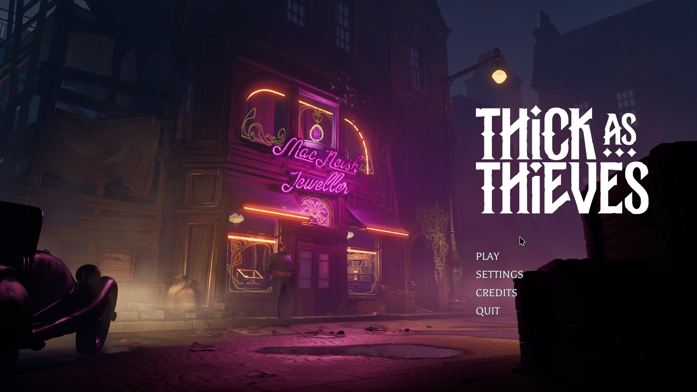

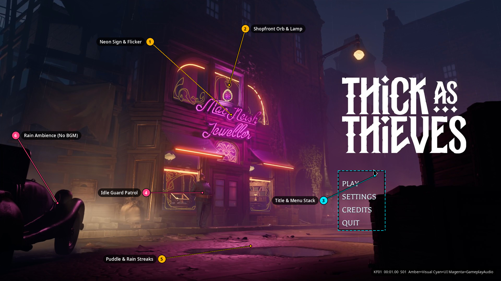

| # | Category | Code | Label | Target (x, y) | Observed UE5 Detail | TAT-2 Ref |
|---|---|---|---|---|---|---|
| 1 | Visual | V1 | Neon Sign & Flicker | (885, 440) | Magenta cursive neon `Mac Neish` / `Jeweller` (lit full at `00:01.00` amidst `00:00.1–00:02.1` flicker) with warm amber window/awning neon bars and Art Nouveau gold scrollwork. | -- |
| 2 | Visual | V2 | Shopfront Orb & Lamp | (878, 326) | Glowing purple egg/orb inside upper Art Nouveau shopframe (`x=848..909, y=290..364`) beneath upper-right warm streetlamp (`x=1375, y=210`). | -- |
| 3 | HUD/UI | UI1 | Title & Menu Stack | (1436, 675) | Right-aligned `THICK AS THIEVES` logo above `PLAY`, `SETTINGS`, `CREDITS`, `QUIT` with cursor approaching `PLAY` (`00:02.0` click, `pk=-33.4 dBFS`). | -- |
| 4 | Gameplay/Audio | G4 | Idle Guard Patrol | (775, 740) | Stationary idle guard in dark uniform, helmet, and brown belt standing before the `Mac Neish` shopfront. | -- |
| 5 | Visual | V2 | Puddle & Rain Streaks | (960, 945) | Rain-slick cobblestones reflecting magenta/amber shopfront neon in foreground puddle with diagonal falling rain streaks. | -- |
| 6 | Gameplay/Audio | AU1 | Rain Ambience (No BGM) | (220, 780) | Steady night rain hiss + distant street air (`-53 to -49 dBFS` RMS, explicit zero BGM) framing vintage car rear fender on left. | -- |

### KF02 - den_entry
(00:04.50, S03)

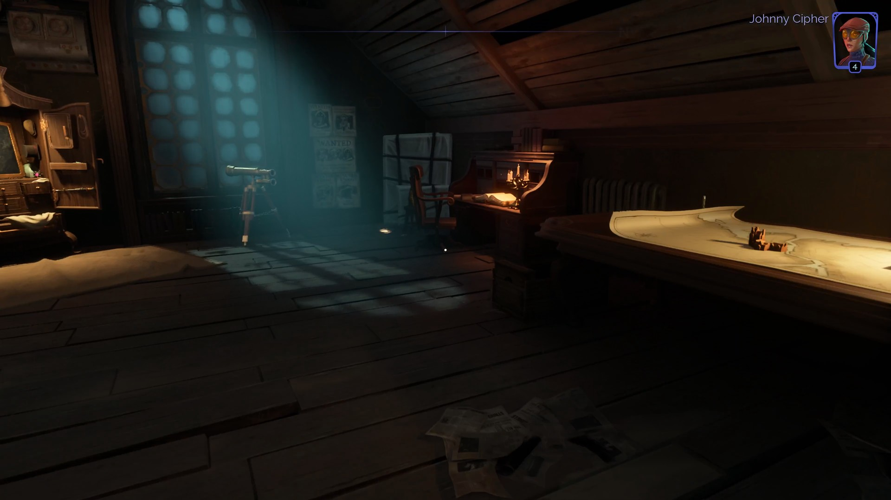

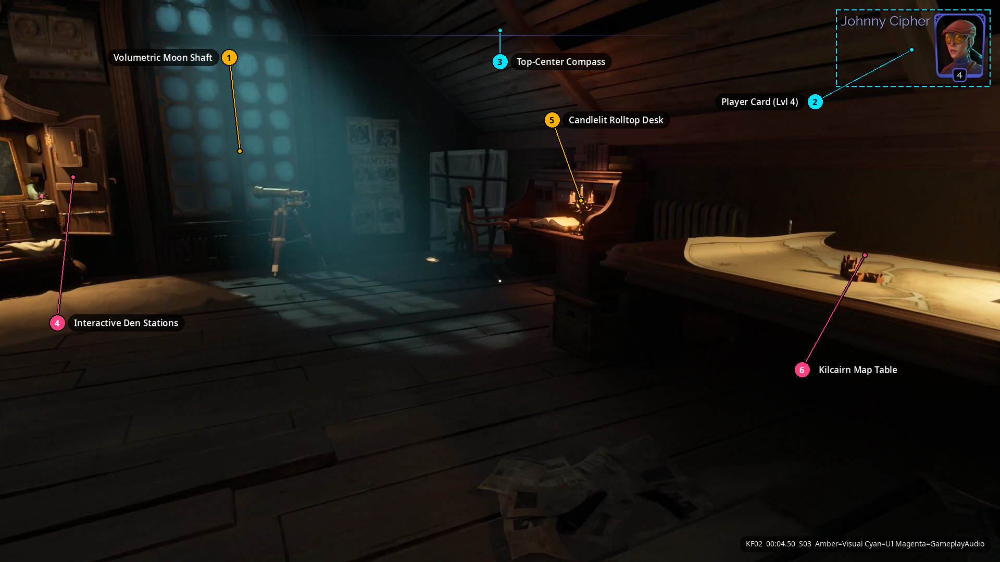

| # | Category | Code | Label | Target (x, y) | Observed UE5 Detail | TAT-2 Ref |
|---|---|---|---|---|---|---|
| 1 | Visual | V1 | Volumetric Moon Shaft | (460, 290) | Volumetric teal-cyan moonlight shaft pouring through arched frosted leaded-glass window, casting mullion shadows across dark floorboards. | -- |
| 2 | HUD/UI | UI3 | Player Card (Lvl 4) | (1750, 95) | Top-right `Johnny Cipher` player card with Spider portrait and level `4` badge fading in by `00:02.70`. | -- |
| 3 | HUD/UI | UI3 | Top-Center Compass | (960, 58) | Subtle horizontal top-center compass bar with center tick and `NW` heading indicator. | -- |
| 4 | Gameplay/Audio | G1 | Interactive Den Stations | (140, 340) | Open illuminated Wardrobe armoire (left) and brass tripod telescope in quiet Thieves' Den (`-76.3 to -73.1 dBFS` room tone, wooden footsteps, no BGM). | -- |
| 5 | Visual | V4 | Candlelit Rolltop Desk | (1115, 385) | Warm point-lit 3-candle candelabra illuminating open Ledger book on rolltop desk, contrasting with cool moonlight shaft. | -- |
| 6 | Gameplay/Audio | G1 | Kilcairn Map Table | (1660, 490) | Mission-selection `KILCAIRN` parchment map table with 3D wooden building tokens; scattered newspapers on foreground floorboards. | -- |

### KF03 - wardrobe_loadout
(00:07.00, S04)

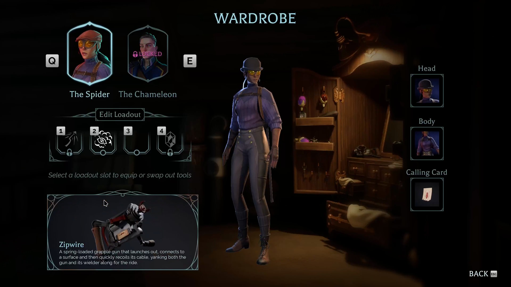

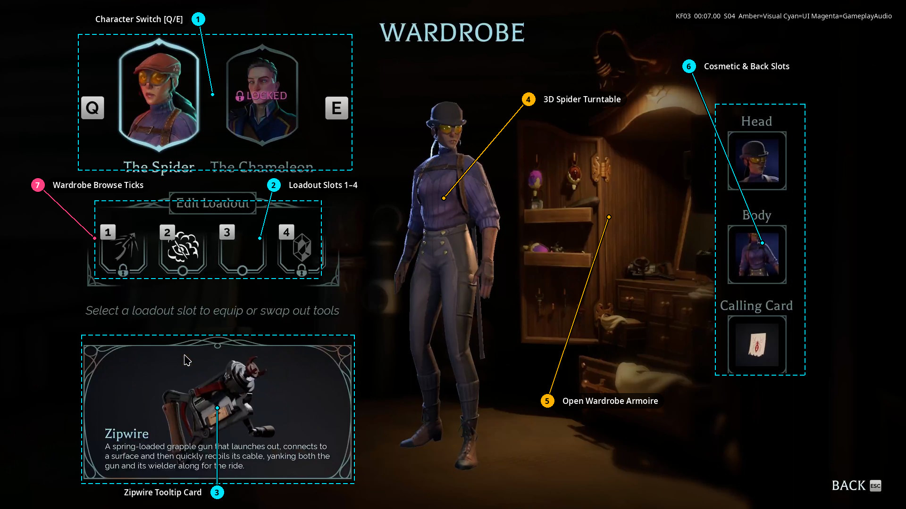

| # | Category | Code | Label | Target (x, y) | Observed UE5 Detail | TAT-2 Ref |
|---|---|---|---|---|---|---|
| 1 | HUD/UI | UI4 | Character Switch [Q/E] | (450, 200) | `[Q]` `The Spider` (selected, cyan border) vs `[E]` `The Chameleon` (`LOCKED` with pink padlock) under `WARDROBE` header. | -- |
| 2 | HUD/UI | UI4 | Loadout Slots 1–4 | (550, 505) | `Edit Loadout` slots `[1]` Zipwire (grey signature lock), `[2]` Smoke Bomb, `[3]` empty, `[4]` Vistara Diamond (grey signature lock). | -- |
| 3 | HUD/UI | UI4 | Zipwire Tooltip Card | (460, 865) | Bottom-left ornate tooltip card showing 3D `Zipwire` grapple gun preview and verbatim grapple-recoil description. | -- |
| 4 | Visual | V5 | 3D Spider Turntable | (940, 420) | 3D `The Spider` character turntable wearing Bowler Hat, yellow goggles, and purple ribbed sweater before open armoire. | -- |
| 5 | Visual | V4 | Open Wardrobe Armoire | (1290, 460) | Open wooden armoire interior lit by overhead curved lamp with hanging bottles/tools; Wardrobe open chime at `00:06.7` (`pk=-23.5 dBFS`, no BGM). | -- |
| 6 | HUD/UI | UI4 | Cosmetic & Back Slots | (1615, 515) | Right customization column (`Head`, `Body`, `Calling Card` spider emblem) above bottom-right `BACK [ESC]` button. | -- |
| 7 | Gameplay/Audio | AU4 | Wardrobe Browse Ticks | (200, 505) | Wardrobe open chime decay after 00:06.7 latch; crisp metallic browse ticks from 00:08.9 (pk -34.6 to -39.4 dBFS); no BGM. | -- |

### KF04 - wardrobe_vistara_diamond
(00:16.50, S04)

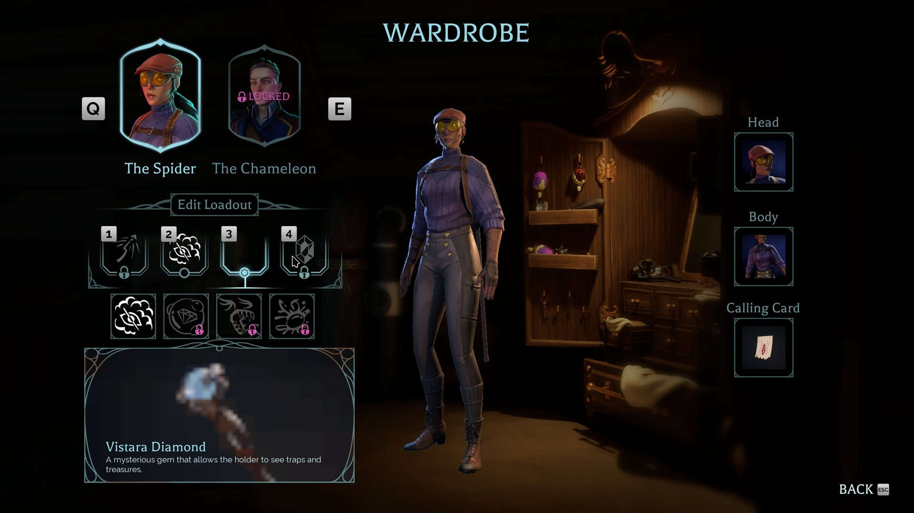

| # | Category | Code | Label | Target (x, y) | Observed UE5 Detail | TAT-2 Ref |
|---|---|---|---|---|---|---|
| 1 | HUD/UI | UI2 | Slot 3 Tool Drawer | (265, 645) | Slot `3` selected (cyan highlight) expanding 4-tool row: `Smoke Bomb` unlocked; `Pickpocket Fairy`, `Insult Fairy`, `Slither Sap` with pink padlocks. | -- |
| 2 | Gameplay/Audio | AU4 | Slot Hover Click SFX | (618, 505) | Cursor hovering Slot `4` (`Vistara Diamond`, grey signature padlock); crisp metallic slot ticks (`pk=-34.6 to -39.4 dBFS`, no BGM). | -- |
| 3 | HUD/UI | UI4 | Vistara Diamond Card | (460, 865) | `Vistara Diamond` tooltip card (`A mysterious gem that allows the holder to see traps and treasures.`) with diamond-caliper preview. | -- |
| 4 | Visual | V5 | Cap Equipped on Spider | (940, 240) | 3D Spider turntable wearing reddish-brown `Cap` headgear (updated from Bowler Hat, mirrored in right `Head` slot). | -- |
| 5 | HUD/UI | UI4 | Updated Head Preview | (1612, 315) | `Head` thumbnail synced to equipped `Cap` alongside `Body` (`Classic`), `Calling Card`, and `BACK [ESC]`. | -- |

### KF05 - telescope_cheese_moon
(00:20.80, S05)

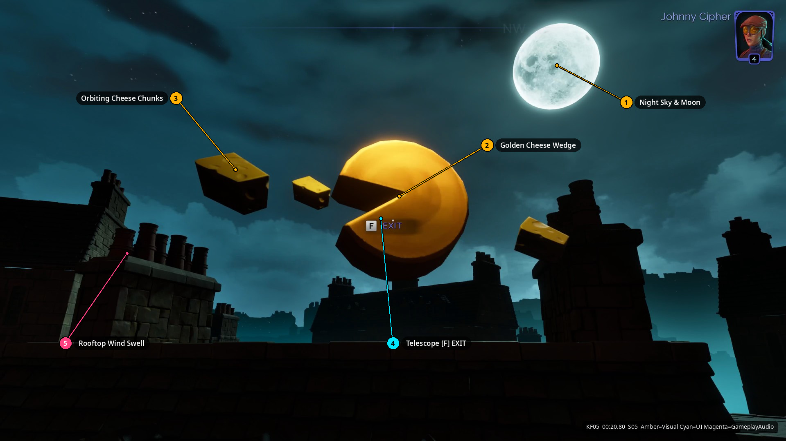

| # | Category | Code | Label | Target (x, y) | Observed UE5 Detail | TAT-2 Ref |
|---|---|---|---|---|---|---|
| 1 | Visual | V2 | Night Sky & Moon | (1360, 160) | Bright crater-textured full moon in upper-right against cloudy teal-blue night sky and faint stars. | -- |
| 2 | Visual | V4 | Golden Cheese Wedge | (975, 480) | Giant rotating golden Pac-Man-shaped cheese wedge (`x=800..1154, y=342..689`) suspended over Kilcairn rooftops. | -- |
| 3 | Visual | V4 | Orbiting Cheese Chunks | (575, 415) | Three porous golden cheese chunks orbiting the central giant wedge (`x~575`, `745`, and `1315`). | -- |
| 4 | HUD/UI | UI2 | Telescope [F] EXIT | (930, 535) | `[F] EXIT` prompt centered in telescope reticle, accompanied by subtle `NW` compass and `Johnny Cipher` (`4`) card. | -- |
| 5 | Gameplay/Audio | AU1 | Rooftop Wind Swell | (310, 620) | Dark Kilcairn chimney silhouettes; exterior wind whoosh swell (`00:19.6–00:21.9`, peaking `-39.5 dBFS` RMS / `-29.8 dBFS` pk, no BGM). | -- |

### KF06 - den_wanted_window
(00:24.60, S05)

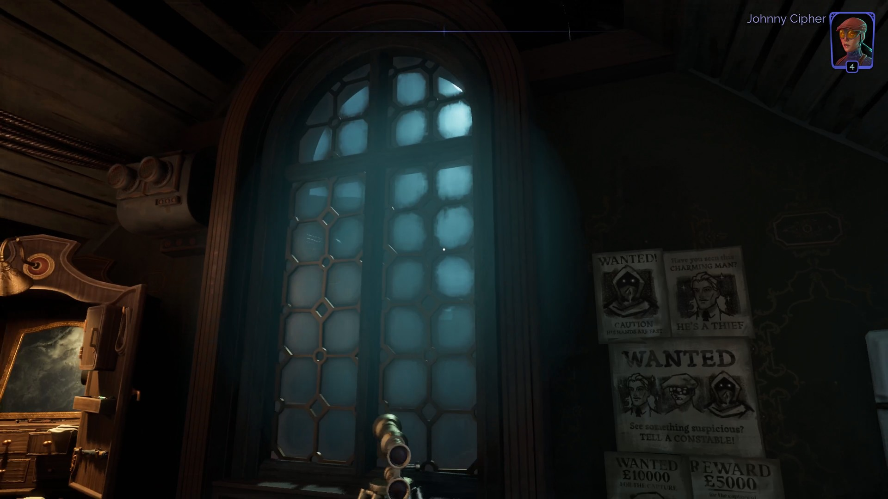

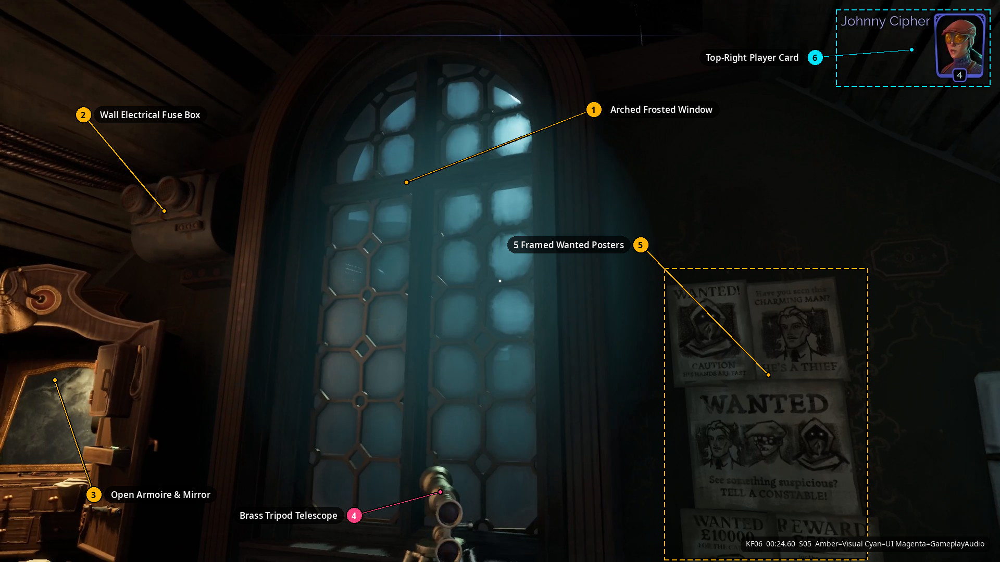

| # | Category | Code | Label | Target (x, y) | Observed UE5 Detail | TAT-2 Ref |
|---|---|---|---|---|---|---|
| 1 | Visual | V1 | Arched Frosted Window | (780, 350) | Arched leaded-glass frosted window radiating a volumetric teal-cyan moonlight shaft into the attic Den. | -- |
| 2 | Visual | V4 | Wall Electrical Fuse Box | (315, 405) | Mounted industrial electrical fuse box with twin circular gauges on left timber wall beside window. | -- |
| 3 | Visual | V4 | Open Armoire & Mirror | (105, 730) | Open illuminated Wardrobe mirror and curved brass wall lamp on far left (`[F] CUSTOMIZE LOADOUT` station). | -- |
| 4 | Gameplay/Audio | G1 | Brass Tripod Telescope | (845, 945) | Brass tripod telescope below window (`[F] PONDER`); wooden footsteps (`00:23.1–00:23.9`, `pk=-27.1 dBFS`) in quiet Den (no BGM). | -- |
| 5 | Visual | V4 | 5 Framed Wanted Posters | (1475, 720) | Five Wanted posters (`HIS HANDS ARE FAST`, `CHARMING MAN?`, `TELL A CONSTABLE!`, `£10000`, `REWARD £5000`) on right wall. | -- |
| 6 | HUD/UI | UI3 | Top-Right Player Card | (1750, 95) | Top-right `Johnny Cipher` card (level `4`) and subtle top-center compass ticks. | -- |

### KF07 - ledger_journal
(00:27.00, S06)

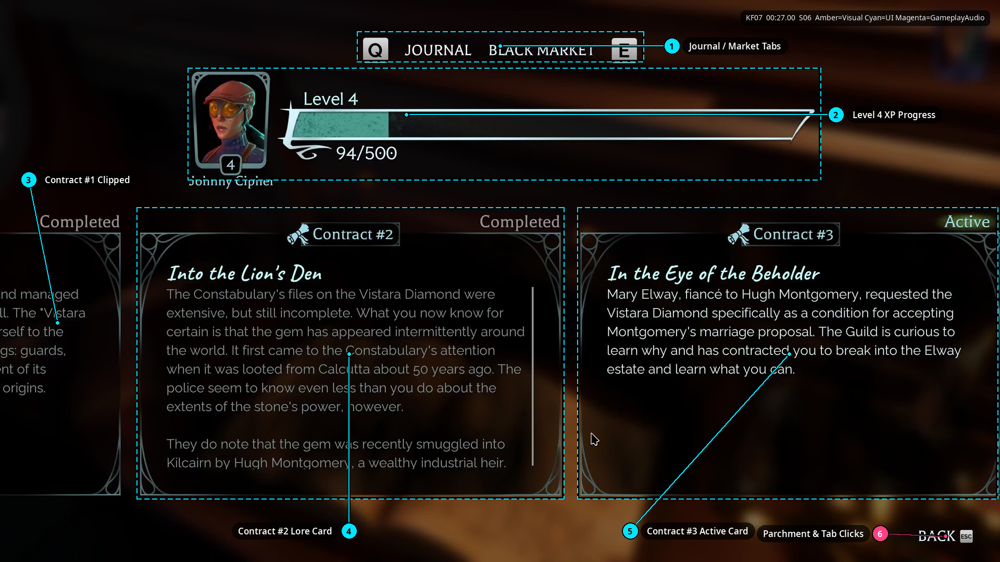

| # | Category | Code | Label | Target (x, y) | Observed UE5 Detail | TAT-2 Ref |
|---|---|---|---|---|---|---|
| 1 | HUD/UI | UI4 | Journal / Market Tabs | (960, 88) | `[Q] JOURNAL` (active) and `BLACK MARKET [E]` Ledger navigation tabs. | -- |
| 2 | HUD/UI | UI4 | Level 4 XP Progress | (780, 220) | `Johnny Cipher` portrait, `Level 4` header, and teal XP progress bar reading `94/500`. | -- |
| 3 | HUD/UI | UI4 | Contract #1 Clipped | (110, 620) | Left-clipped `Completed` `Contract #1` card (`...nd managed... The "Vistara... origins.`). | -- |
| 4 | HUD/UI | UI4 | Contract #2 Lore Card | (670, 680) | `Completed` `Contract #2` — *Into the Lion's Den* detailing Vistara Diamond looted from Calcutta 50 years ago and smuggled by Hugh Montgomery. | -- |
| 5 | HUD/UI | UI4 | Contract #3 Active Card | (1515, 680) | `Active` `Contract #3` — *In the Eye of the Beholder* (Mary Elway & Hugh Montgomery marriage condition) with cursor. | -- |
| 6 | Gameplay/Audio | AU4 | Parchment & Tab Clicks | (1815, 1030) | `BACK [ESC]` prompt; Ledger opens with crisp parchment rustle & tab clicks (`00:26.6–00:27.1`, `pk=-30.4 dBFS`, zero BGM). | -- |

### KF08 - ledger_black_market
(00:28.50, S06)

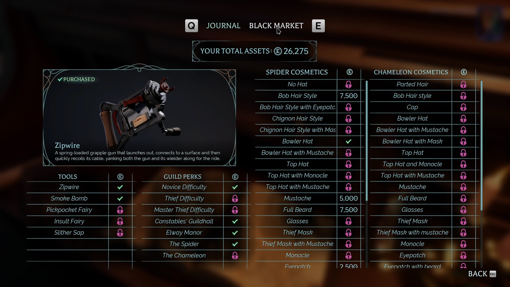

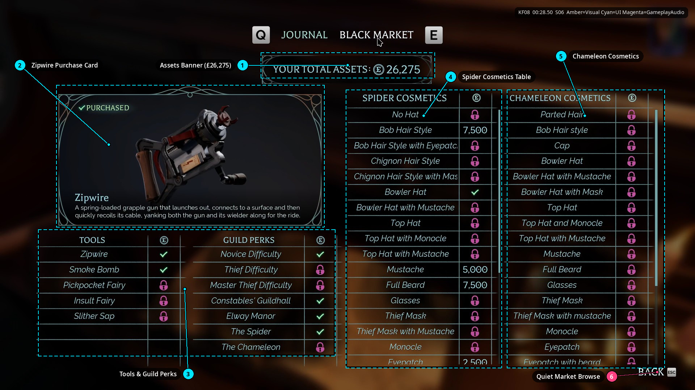

| # | Category | Code | Label | Target (x, y) | Observed UE5 Detail | TAT-2 Ref |
|---|---|---|---|---|---|---|
| 1 | HUD/UI | UI4 | Assets Banner (£26,275) | (960, 180) | `BLACK MARKET [E]` active tab (hovered by cursor) above `YOUR TOTAL ASSETS: (£) 26,275`. | -- |
| 2 | HUD/UI | UI4 | Zipwire Purchase Card | (300, 400) | Selected `Zipwire` preview box showing `✓ PURCHASED` badge, 3D model, and grapple description. | -- |
| 3 | HUD/UI | UI4 | Tools & Guild Perks | (510, 800) | `TOOLS` (`Zipwire`, `Smoke Bomb` `✓`; 3 fairies/sap `🔒`) and `GUILD PERKS` (`Novice`, `Guildhall`, `Elway Manor`, `The Spider` `✓`; `Thief`/`Master`/`Chameleon` `🔒`). | -- |
| 4 | HUD/UI | UI4 | Spider Cosmetics Table | (1170, 320) | Scrollable `SPIDER COSMETICS` column showing `✓` (`Bowler Hat`), prices (`7,500`, `5,000`, `2,500`), and pink padlocks (`🔒`). | -- |
| 5 | HUD/UI | UI5 | Chameleon Cosmetics | (1615, 320) | Scrollable `CHAMELEON COSMETICS` column showing all 17 visible entries locked with pink padlocks (`🔒`). | -- |
| 6 | Gameplay/Audio | AU4 | Quiet Market Browse | (1815, 1030) | `BACK [ESC]` prompt; tab click (`00:28.0`, `pk=-34.5 dBFS`) followed by `~5.8 s` quiet reading (`-68 dBFS` room tone, zero BGM). | -- |

### KF09 - den_gramophone
(00:46.25, S07)

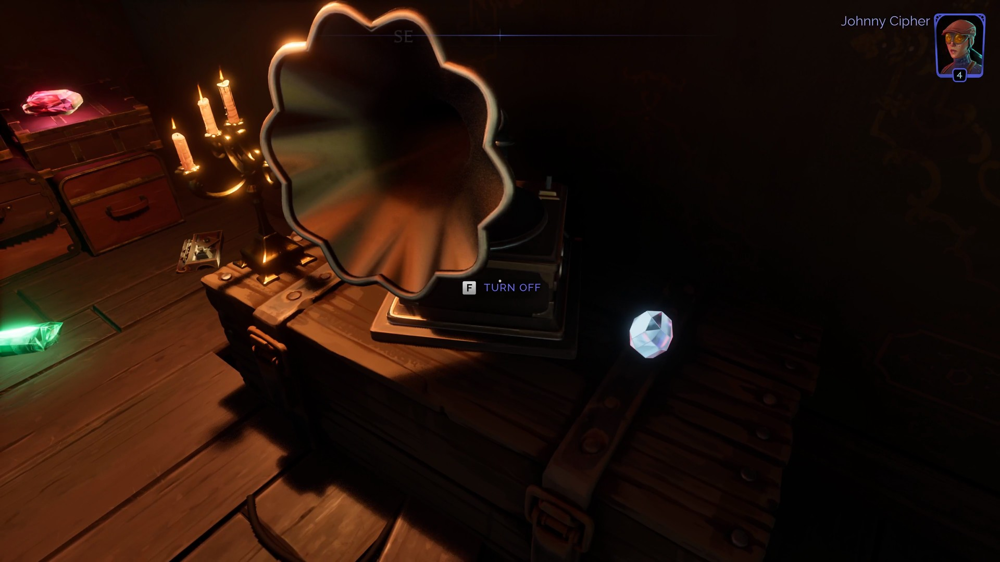

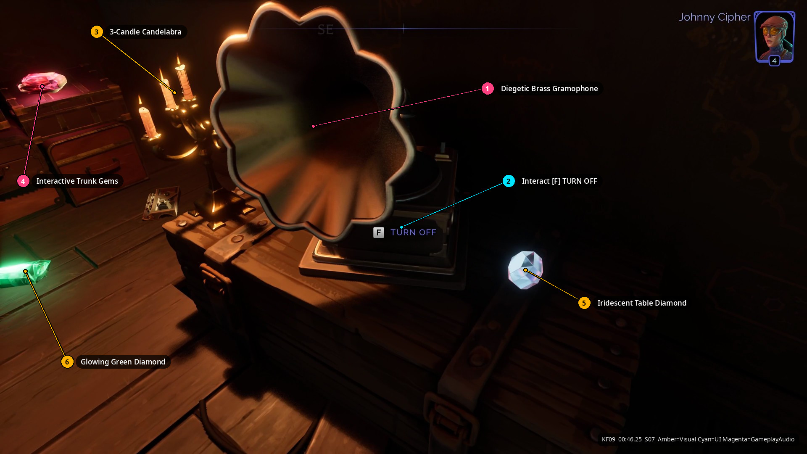

| # | Category | Code | Label | Target (x, y) | Observed UE5 Detail | TAT-2 Ref |
|---|---|---|---|---|---|---|
| 1 | Gameplay/Audio | AU2 | Diegetic Brass Gramophone | (745, 300) | **ONLY music in clip:** brass-horn Gramophone playing warped wind-up + scratchy 1920s jazz/ragtime with vinyl crackle (`00:45.4–00:47.8`, `pk=-24.9 dBFS`). | -- |
| 2 | HUD/UI | UI2 | Interact [F] TURN OFF | (955, 540) | Center reticle `[F] TURN OFF` prompt (flipped from `[F] TURN ON` after switch click at `00:44.4`) with subtle `SE` compass above. | -- |
| 3 | Visual | V1 | 3-Candle Candelabra | (415, 220) | Warm 3-candle candelabra casting amber highlights onto the fluted brass horn and wooden trunk. | -- |
| 4 | Gameplay/Audio | G1 | Interactive Trunk Gems | (100, 205) | Faceted pink gem resting atop stacked trunks (swappable via `[F] CHANGE DECORATION` alongside Fabergé egg / golden chalice). | -- |
| 5 | Visual | V2 | Iridescent Table Diamond | (1250, 642) | Faceted iridescent white-blue diamond shader on chest top beside Gramophone. | -- |
| 6 | Visual | V3 | Glowing Green Diamond | (60, 645) | Emissive faceted green diamond resting on left floorboards beside trunk shadow. | -- |

### KF10 - den_map_table
(00:52.35, S08)

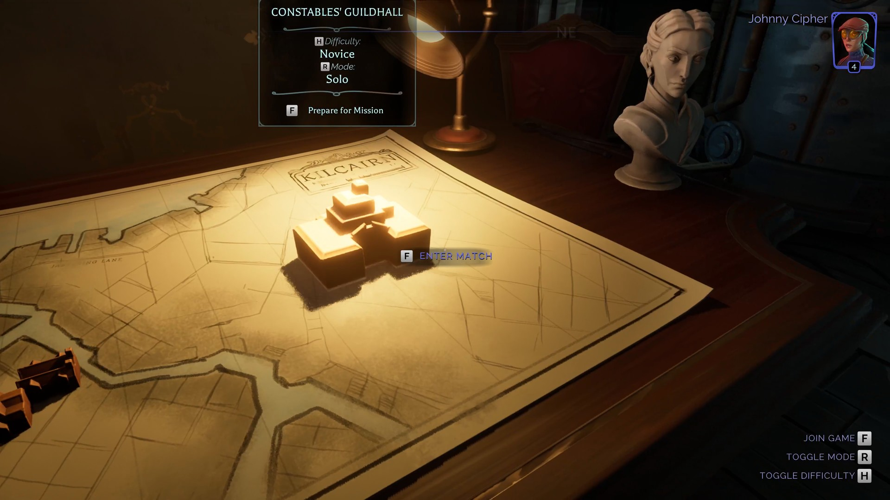

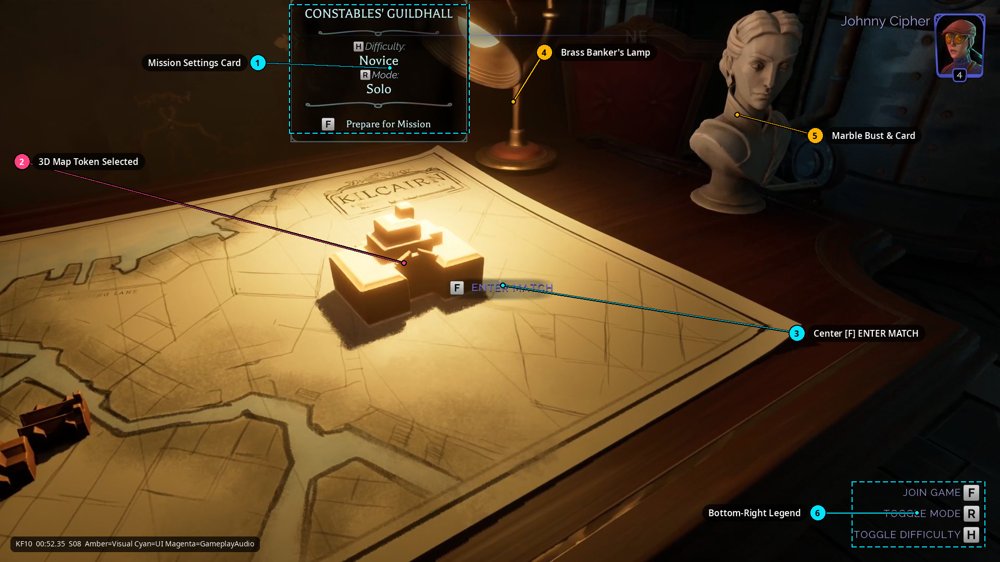

| # | Category | Code | Label | Target (x, y) | Observed UE5 Detail | TAT-2 Ref |
|---|---|---|---|---|---|---|
| 1 | HUD/UI | UI4 | Mission Settings Card | (748, 130) | Top-center floating card: `CONSTABLES' GUILDHALL`, `[H] Difficulty: Novice`, `[R] Mode: Solo`, `[F] Prepare for Mission`. | -- |
| 2 | Gameplay/Audio | G1 | 3D Map Token Selected | (775, 505) | Highlighted 3D wooden `CONSTABLES' GUILDHALL` token on `KILCAIRN` parchment map (second `ELWAY MANOR` token bottom-left). | -- |
| 3 | HUD/UI | UI2 | Center [F] ENTER MATCH | (965, 548) | Center reticle `[F] ENTER MATCH` prompt over illuminated parchment map; Map Table toggle clicks (`00:52.2–00:55.1`, `pk=-38.3 dBFS`, no BGM). | -- |
| 4 | Visual | V1 | Brass Banker's Lamp | (985, 195) | Brass banker's lamp casting warm directional pool across `KILCAIRN` map & Guildhall token (`NE` compass visible above). | -- |
| 5 | Visual | V4 | Marble Bust & Card | (1415, 220) | Classical white marble bust on table corner beside top-right `Johnny Cipher` (`4`) player card. | -- |
| 6 | HUD/UI | UI3 | Bottom-Right Legend | (1760, 985) | Bottom-right keybind legend (`JOIN GAME [F]`, `TOGGLE MODE [R]`, `TOGGLE DIFFICULTY [H]`). | -- |

### KF11 - mission_prep_countdown
(01:00.30, S09)

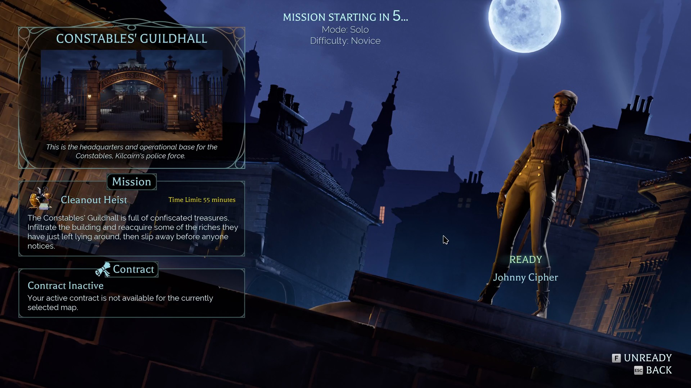

| # | Category | Code | Label | Target (x, y) | Observed UE5 Detail | TAT-2 Ref |
|---|---|---|---|---|---|---|
| 1 | HUD/UI | UI5 | 6s Prep Countdown | (955, 48) | "MISSION STARTING IN 5... / Mode: Solo / Difficulty: Novice" centered top HUD during active 6 s countdown (00:58.9–01:04.8). | -- |
| 2 | HUD/UI | UI4 | Map & Mission Cards | (685, 240) | Stacked Art-Nouveau bordered cards: "CONSTABLES' GUILDHALL" (gate preview), "Cleanout Heist", "Time Limit: 55 minutes" (matches Briefing). | -- |
| 3 | HUD/UI | UI4 | Contract Inactive Card | (680, 805) | Bottom-left card reading "Contract Inactive: Your active contract is not available for the currently selected map." | -- |
| 4 | Visual | V1 | Moon & Searchlights | (1455, 72) | Full moon upper-right casting cool blue-slate rim lighting and angled volumetric searchlight beams across gothic Kilcairn rooftops. | -- |
| 5 | Visual | V5 | 3D Spider Rooftop Pose | (1545, 430) | 3D Spider character ("Johnny Cipher") standing on slate roof ridge wearing cap, goggles, and belt pouches. | -- |
| 6 | Gameplay/Audio | AU4 | Ready & Countdown Ticks | (1460, 745) | Green "READY" toggle ([F] UNREADY / [ESC] BACK) paired with 6 percussive UI ticks at 1.00 s intervals (00:59.0–01:04.0). | -- |

### KF12 - loading_screen
(01:06.50, S10)

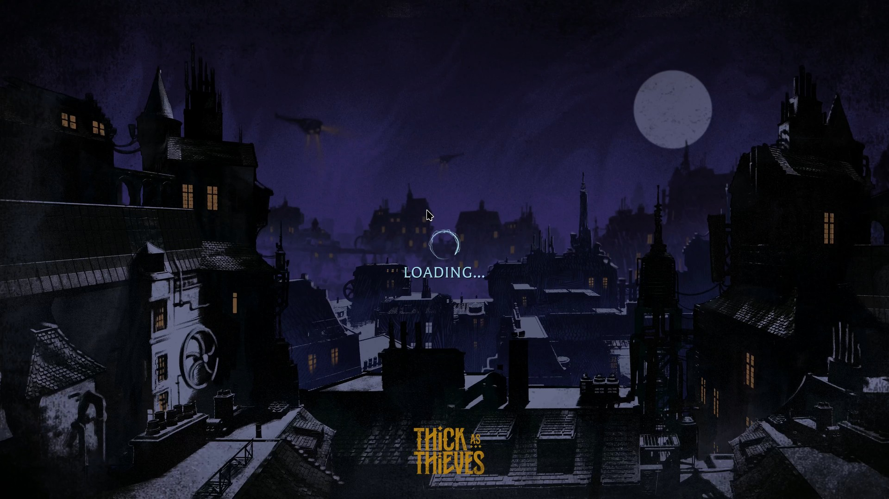

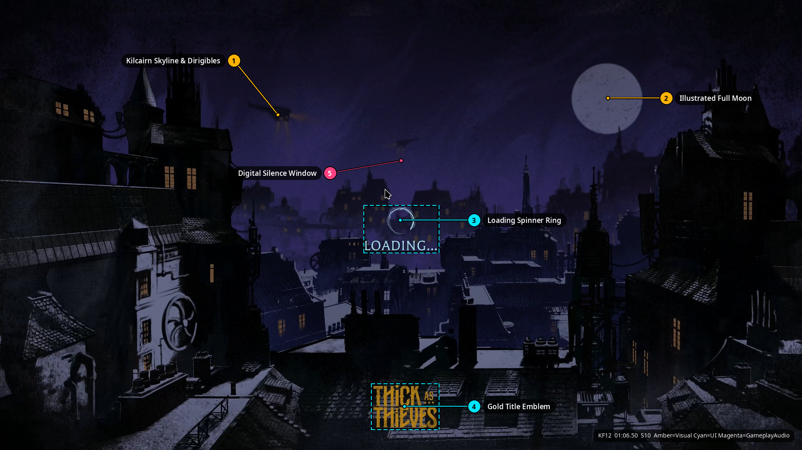

| # | Category | Code | Label | Target (x, y) | Observed UE5 Detail | TAT-2 Ref |
|---|---|---|---|---|---|---|
| 1 | Visual | V2 | Kilcairn Skyline & Dirigibles | (665, 275) | Dark-indigo illustrated Kilcairn rooftop silhouette with twin airship dirigibles sweeping warm yellow searchlight cones. | -- |
| 2 | Visual | V2 | Illustrated Full Moon | (1455, 235) | Textured pale full moon in upper-right violet-indigo sky illuminating rooftop ridges and circular fan facade (left). | -- |
| 3 | HUD/UI | UI4 | Loading Spinner Ring | (958, 528) | Centered rotating cyan/white circular ring above crisp "LOADING..." text (Loading Screen 2, 01:04.80–01:09.44). | -- |
| 4 | HUD/UI | UI4 | Gold Title Emblem | (968, 975) | Bottom-center gold stylized "THICK AS THIEVES" stacked emblem with diamond flourish. | -- |
| 5 | Gameplay/Audio | AU1 | Digital Silence Window | (960, 385) | True digital silence (-240.0 dBFS, 01:04.94–01:07.78) with zero loading music before rain fades in at 01:07.78. | -- |

### KF13 - briefing_letter
(01:10.00, S11)

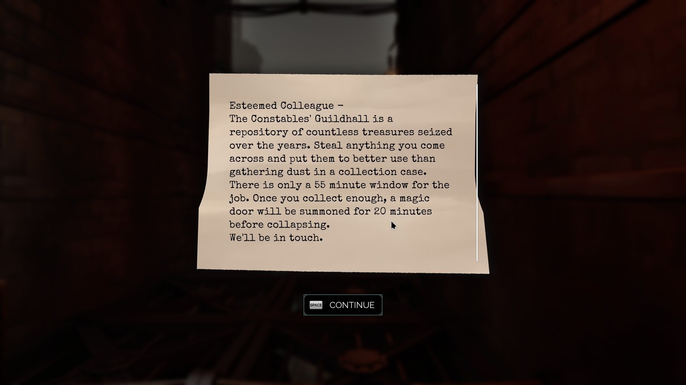

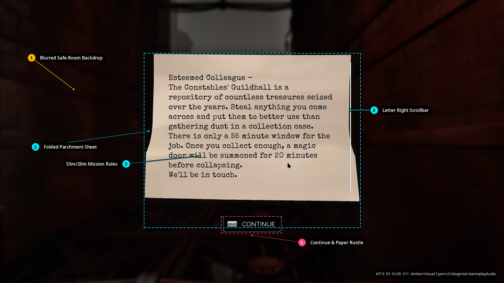

| # | Category | Code | Label | Target (x, y) | Observed UE5 Detail | TAT-2 Ref |
|---|---|---|---|---|---|---|
| 1 | Visual | V7 | Blurred Safe-Room Backdrop | (280, 340) | Darkened depth-of-field / Gaussian blur over Guildhall safe-room brick wall and iron grate window behind modal. | -- |
| 2 | HUD/UI | UI4 | Folded Parchment Sheet | (565, 500) | Centered folded cream parchment sheet with horizontal crease shadow and 11-line typewriter briefing text. | -- |
| 3 | HUD/UI | UI4 | 55m/20m Mission Rules | (760, 595) | Verbatim briefing specifies "55 minute window" (matching Mission Prep) and "magic door ... summoned for 20 minutes". | -- |
| 4 | HUD/UI | UI4 | Letter Right Scrollbar | (1335, 420) | Thin bright vertical scrollbar along right inner margin of parchment letter. | -- |
| 5 | Gameplay/Audio | AU3 | Continue & Paper Rustle | (960, 898) | "[SPACE] CONTINUE" button below letter; opening/dismissing plays crisp paper rustle (01:09.5–01:10.3) over exterior rain. | -- |

### KF14 - saferoom_portal_hud
(01:15.75, S12)

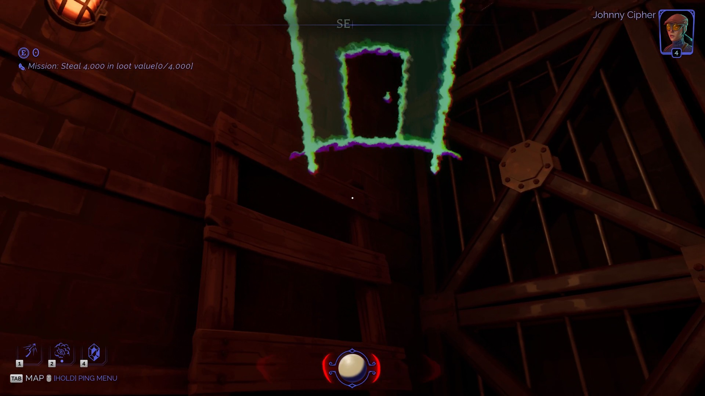

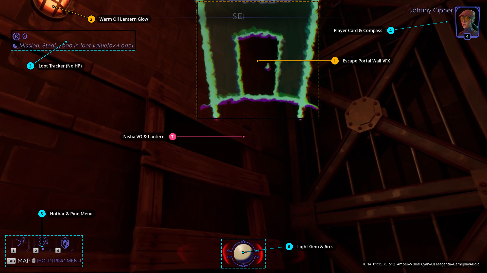

| # | Category | Code | Label | Target (x, y) | Observed UE5 Detail | TAT-2 Ref |
|---|---|---|---|---|---|---|
| 1 | Visual | V6 | Escape Portal Wall VFX | (1015, 240) | Jagged glowing emerald-green and violet chromatic-edge Escape Portal outline shimmering on safe-room wall (01:15.2–01:16.2). | -- |
| 2 | Visual | V1 | Warm Oil Lantern Glow | (210, 25) | Ignited caged wall lantern casting warm orange bounce light on dark brick beside dark iron grate catwalk. | -- |
| 3 | HUD/UI | UI3 | Loot Tracker (No HP) | (260, 165) | Top-left "(£) 0" and "Mission: Steal 4,000 in loot value[0/4,000]"; Health Bar stays hidden at 100% HP until 02:23.30. | -- |
| 4 | HUD/UI | UI3 | Player Card & Compass | (1760, 85) | Top-right "Johnny Cipher" (Level 4, Spider portrait) and subtle top-center "SE" compass bar. | -- |
| 5 | HUD/UI | UI3 | Hotbar & Ping Menu | (165, 975) | Bottom-left tool slots [1] Zipwire, [2] Smoke Bomb, [4] Vistara Diamond plus "[TAB] MAP [MMB] [HOLD] PING MENU". | -- |
| 6 | HUD/UI | UI5 | Light Gem & Arcs | (958, 998) | Bottom-center stealth Light Gem glowing warm cream-gold (lit by lantern) flanked by faint red directional threat arcs. | -- |
| 7 | Gameplay/Audio | AU6 | Nisha VO & Lantern | (960, 540) | ThiefNisha VO "Let the thieving begin." (01:11.6–01:13.1) and lantern ignite click-whoosh (01:15.1); zero BGM. | -- |

### KF15 - alley_barrons_demolition
(01:21.38, S13)

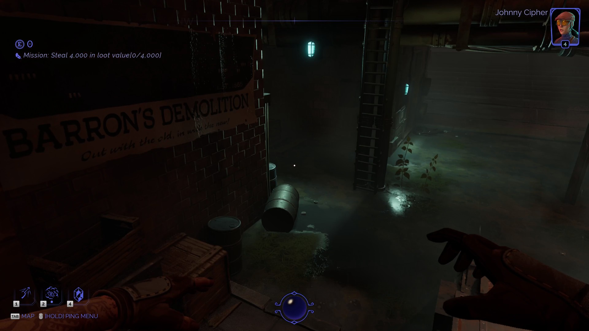

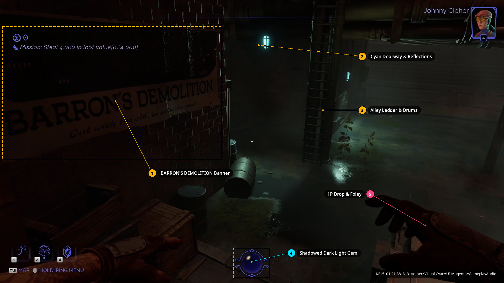

| # | Category | Code | Label | Target (x, y) | Observed UE5 Detail | TAT-2 Ref |
|---|---|---|---|---|---|---|
| 1 | Visual | V4 | BARRON'S DEMOLITION Banner | (440, 385) | Weathered brick wall banner reading "BARRON'S DEMOLITION" (faint "EST. 1865") and "Out with the old, in with the new!". | -- |
| 2 | Visual | V1 | Cyan Doorway & Reflections | (985, 172) | Teal-cyan caged bulkhead light illuminating rain-slicked alley cobblestones, puddle speculars, and metal wall ladder. | -- |
| 3 | Visual | V4 | Alley Ladder & Drums | (1230, 420) | Vertical steel access ladder beside brick corner, crates, fallen steel oil drums, and sparse alley weeds. | -- |
| 4 | HUD/UI | UI3 | Shadowed Dark Light Gem | (958, 998) | Bottom-center Light Gem rests in deep indigo-blue (full shadow concealment) with zero threat arcs. | -- |
| 5 | Gameplay/Audio | G2 | 1P Drop & Foley | (1620, 860) | 1P gloved hands & forearm brace alley drop; rain ambience (-49 dBFS) transitions to wet cobble footsteps & puddle splashes. | -- |

### KF16 - zipwire_gate_headlights
(01:40.20, S14)

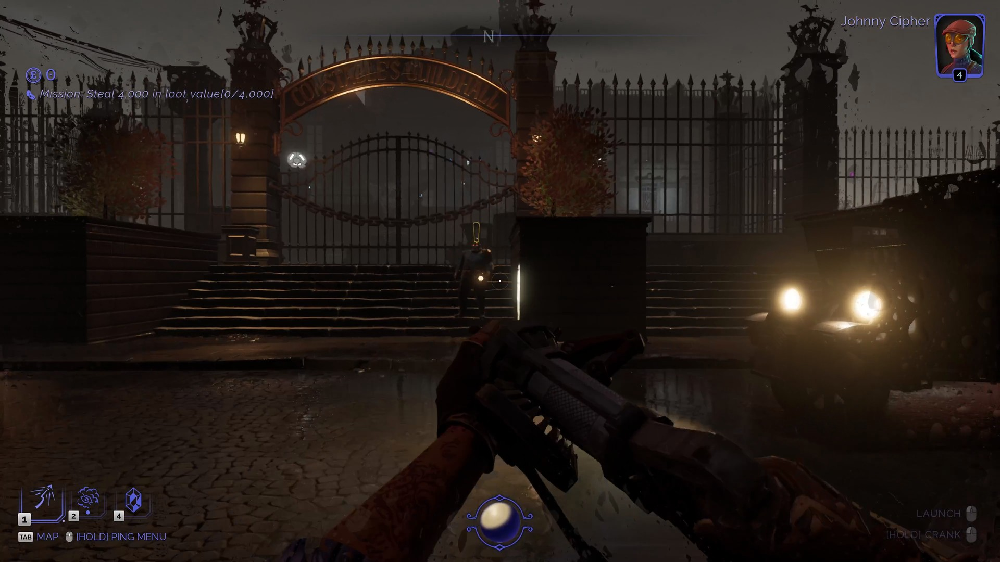

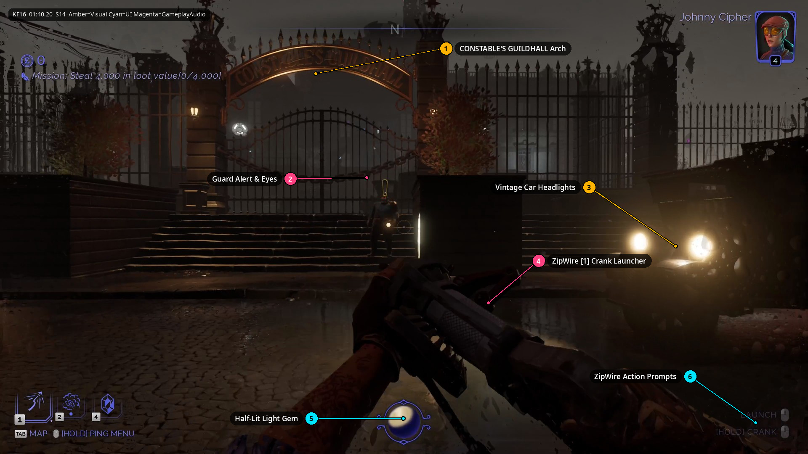

| # | Category | Code | Label | Target (x, y) | Observed UE5 Detail | TAT-2 Ref |
|---|---|---|---|---|---|---|
| 1 | Visual | V4 | CONSTABLE'S GUILDHALL Arch | (750, 175) | Wrought-iron perimeter gate arch bearing gilded "CONSTABLE'S GUILDHALL" lettering and crowned stone pillars. | -- |
| 2 | Gameplay/Audio | G4 | Guard Alert & Eyes | (871, 422) | Alerted constable inside gate with glowing red eyes, hip flashlight, vertical yellow alert bar, and VO "I know someone's here!" (01:39.3–01:40.6). | -- |
| 3 | Visual | V1 | Vintage Car Headlights | (1605, 585) | Flashing dual headlights on parked vintage car (triggered by [F] INTERACT + double-honk at 01:35.68) casting glare across wet cobbles. | -- |
| 4 | Gameplay/Audio | G3 | ZipWire [1] Crank Launcher | (1160, 720) | 1P mechanical spring-loaded ZipWire crank launcher equipped in slot [1] (no fall damage occurs on 01:44 foliage drop). | -- |
| 5 | HUD/UI | UI3 | Half-Lit Light Gem | (958, 995) | Half-lit white/indigo Light Gem reflecting partial headlight/streetlamp exposure while bottom-right shows LAUNCH [LMB] / [HOLD] CRANK [RMB]. | -- |
| 6 | HUD/UI | UI2 | ZipWire Action Prompts | (1795, 1005) | Bottom-right tool prompts: "LAUNCH [LMB]" and "[HOLD] CRANK [RMB]" paired with white-highlighted slot [1] bottom-left. | -- |

### KF17 - zipwire_aim_roof
(01:51.20, S15)

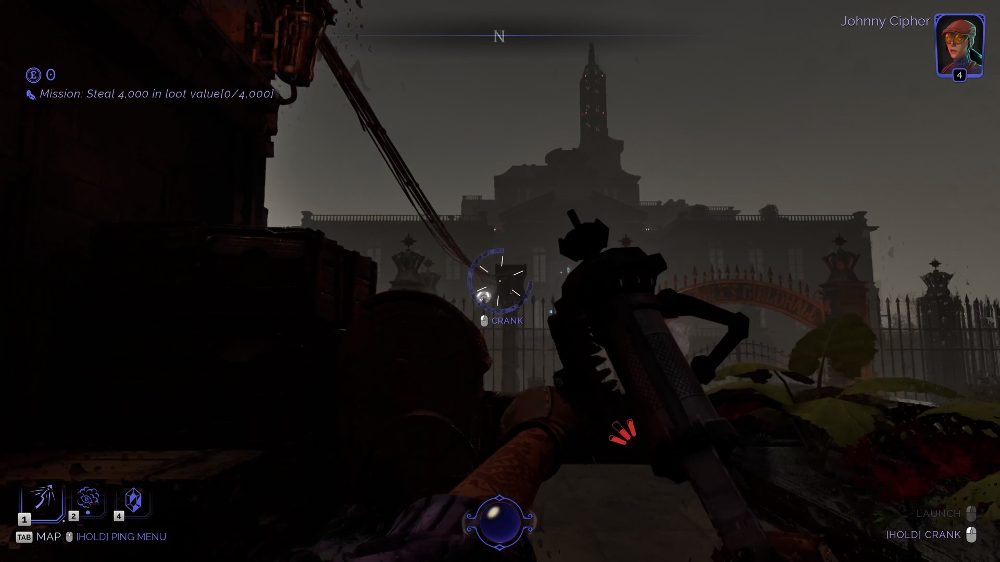

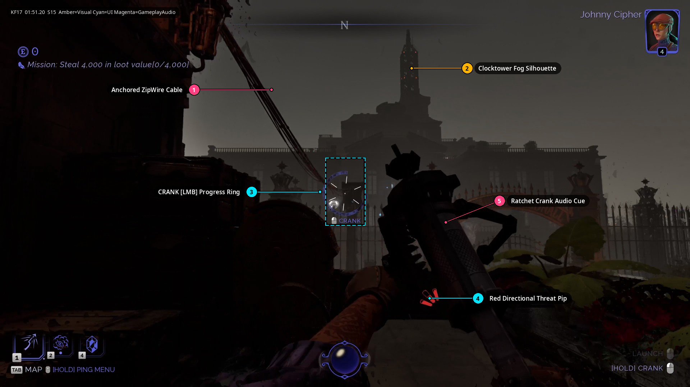

| # | Category | Code | Label | Target (x, y) | Observed UE5 Detail | TAT-2 Ref |
|---|---|---|---|---|---|---|
| 1 | Gameplay/Audio | G3 | Anchored ZipWire Cable | (755, 250) | 2nd ZipWire shot anchored to upper brick roof parapet; accompanied by spring launch (01:51.7) and cable zip whine (01:52.2). | -- |
| 2 | Visual | V2 | Clocktower Fog Silhouette | (1145, 190) | Distant Guildhall spire/clocktower silhouette with tiny red window accents emerging through volumetric night mist. | -- |
| 3 | HUD/UI | UI2 | CRANK [LMB] Progress Ring | (890, 535) | Center-screen radial segmented progress ring displaying "CRANK [LMB]" while cable attaches for facade ascent. | -- |
| 4 | HUD/UI | UI5 | Red Directional Threat Pip | (1195, 832) | Three-dash crimson directional alert indicator pulsing over lower-right view as patrolling guard shouts "Oh, I will find you, thief!". | -- |
| 5 | Gameplay/Audio | AU5 | Ratchet Crank Audio Cue | (1240, 620) | 1P ZipWire crank handle initiates rhythmic ratchet hand-cranking SFX (01:56.1–02:01.2, pk=-22.2 dBFS) during roof climb. | -- |

### KF18 - guildhall_arch_overlook
(02:14.80, S17)

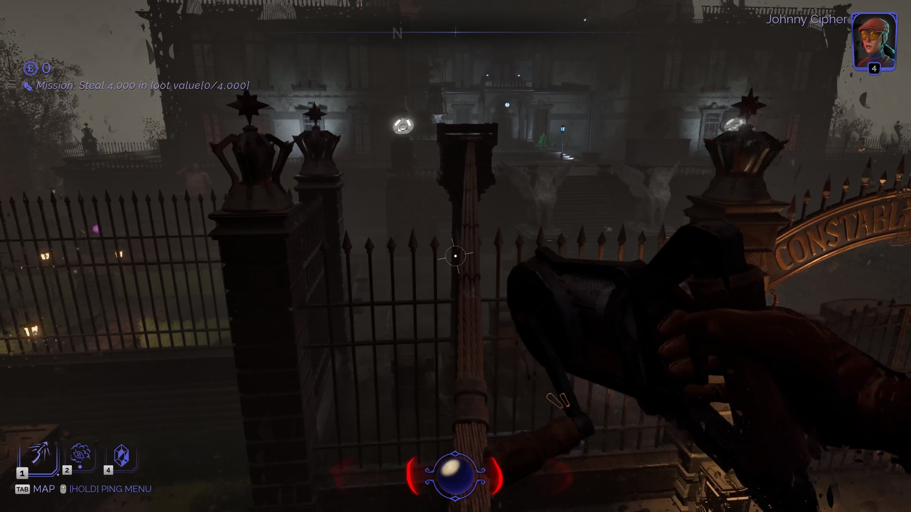

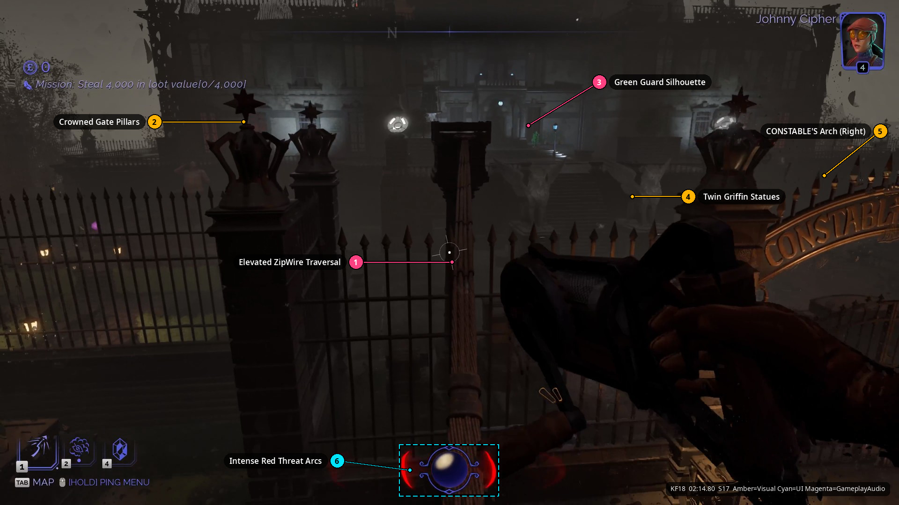

| # | Category | Code | Label | Target (x, y) | Observed UE5 Detail | TAT-2 Ref |
|---|---|---|---|---|---|---|
| 1 | Gameplay/Audio | G2 | Elevated ZipWire Traversal | (965, 560) | Mid-cable traversal overlooking courtyard (02:11.00–02:17.00) with center reticle dot and ratchet clicks (02:13.4–02:15.1). | -- |
| 2 | Visual | V4 | Crowned Gate Pillars | (520, 260) | Ornate star-topped crown finials atop wrought-iron perimeter gate pillars framing Guildhall courtyard. | -- |
| 3 | Gameplay/Audio | G4 | Green Guard Silhouette | (1128, 268) | Patrolling constable beneath portico highlighted in bright green silhouette across courtyard fog. | -- |
| 4 | Visual | V4 | Twin Griffin Statues | (1350, 420) | Pair of winged stone griffin statues perched on brick pedestals flanking Guildhall grand exterior staircase. | -- |
| 5 | Visual | V4 | CONSTABLE'S Arch (Right) | (1760, 375) | Partial wrought-iron "CONSTABL..." arch lettering visible at right edge from elevated gate-pillar cable angle. | -- |
| 6 | HUD/UI | UI5 | Intense Red Threat Arcs | (875, 1005) | Twin bright-red directional threat/alert arcs bracketing dark indigo Light Gem during high-elevation crossing. | -- |

### KF19 - smoke_bomb_equip
(02:25.40, S18)

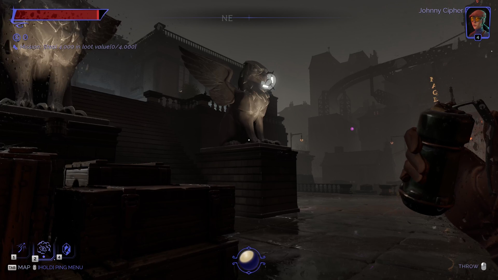

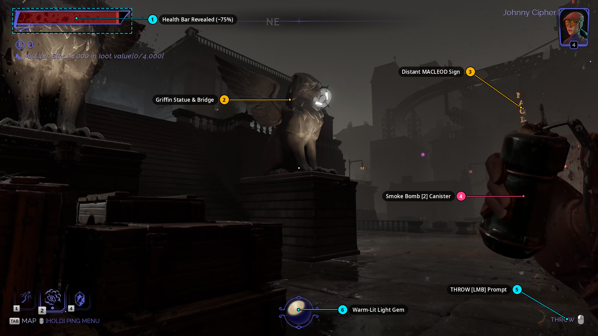

| # | Category | Code | Label | Target (x, y) | Observed UE5 Detail | TAT-2 Ref |
|---|---|---|---|---|---|---|
| 1 | HUD/UI | UI3 | Health Bar Revealed (~75%) | (245, 58) | Ornate Art-Nouveau Health Bar appears post-02:23.30 courtyard fall damage (red_px: 0->27,560), settled at ~75% fill. | -- |
| 2 | Visual | V4 | Griffin Statue & Bridge | (930, 320) | Wet sculpted stone griffin statue on brick plinth beside wooden crates and overhead iron bridge silhouette in fog. | -- |
| 3 | Visual | V4 | Distant MACLEOD Sign | (1672, 345) | Vertical illuminated gold serif "MACL..." ("MACLEOD") sign glowing through night mist on distant right facade. | -- |
| 4 | Gameplay/Audio | G3 | Smoke Bomb [2] Canister | (1680, 630) | 1P gloved right hand grips dark cylindrical Smoke Bomb canister with lever; slot [2] active bottom-left. Guard VO: Hey! Show yourself! (02:24.8-02:26.0, pk -33.3 dBFS); no BGM. | -- |
| 5 | HUD/UI | UI2 | THROW [LMB] Prompt | (1820, 1025) | Bottom-right action prompt switches to "THROW [LMB]" matching equipped Smoke Bomb [2]. | -- |
| 6 | HUD/UI | UI3 | Warm-Lit Light Gem | (958, 995) | Light Gem glows warm cream-gold on wet courtyard flagstones (Guard VO: "Hey! Show yourself!" at 02:24.8–02:26.0). | -- |

### KF20 - smoke_bomb_plume
(02:29.20, S18)

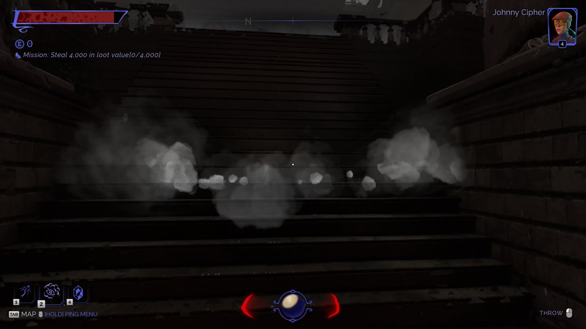

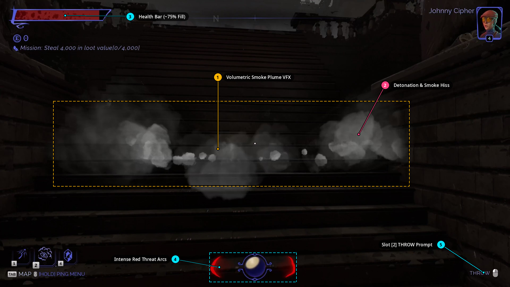

| # | Category | Code | Label | Target (x, y) | Observed UE5 Detail | TAT-2 Ref |
|---|---|---|---|---|---|---|
| 1 | Visual | V6 | Volumetric Smoke Plume VFX | (820, 560) | Opaque grey-white volumetric smoke puffs expanding horizontally across grand stairs post-02:28.20 ignition flash to block line-of-sight. | -- |
| 2 | Gameplay/Audio | AU5 | Detonation & Smoke Hiss | (1350, 505) | Detonation pop + sustained pressurized hiss/whoosh (02:28.3–02:29.8, pk=-20.5 dBFS) followed by guard cough & VO. | -- |
| 3 | HUD/UI | UI3 | Health Bar (~75% Fill) | (245, 58) | Ornate top-left Health Bar remains visible below 100% HP (~75% fill) above "(£) 0" and loot mission tracker. | -- |
| 4 | HUD/UI | UI5 | Intense Red Threat Arcs | (825, 1005) | Wide twin red directional threat arcs flaring around lit Light Gem as guard reacts ("You stop making noise, you dog!"). | -- |
| 5 | HUD/UI | UI2 | Slot [2] THROW Prompt | (1820, 1025) | Smoke Bomb slot [2] remains active bottom-left with "THROW [LMB]" bottom-right after canister throw. | -- |

### KF21 - vistara_diamond_red_guard
(02:32.20, S19)

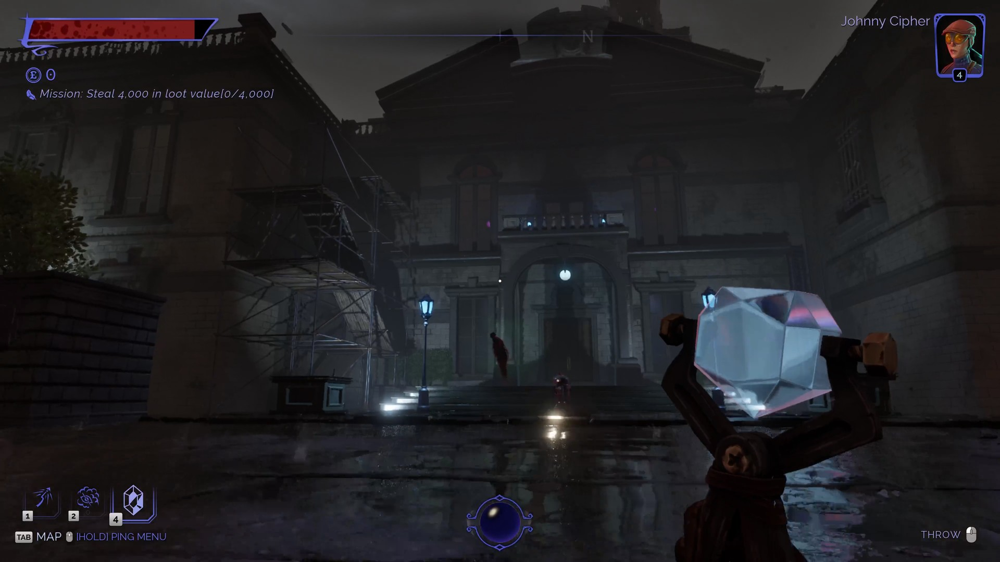

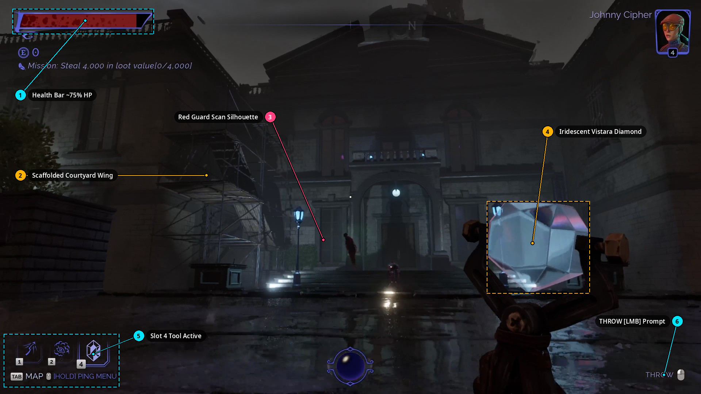

| # | Category | Code | Label | Target (x, y) | Observed UE5 Detail | TAT-2 Ref |
|---|---|---|---|---|---|---|
| 1 | HUD/UI | UI3 | Health Bar ~75% HP | (233, 56) | Ornate top-left Health Bar visible post-02:23.30 fall damage, drained to ~75% red fill above '(£) 0' and 'Mission: Steal 4,000 in loot value[0/4,000]'. | -- |
| 2 | Visual | V4 | Scaffolded Courtyard Wing | (565, 480) | Multi-tier tubular metal and timber scaffolding rigged against the wet stone left courtyard wing. | -- |
| 3 | Gameplay/Audio | G4 | Red Guard Scan Silhouette | (885, 657) | Patrolling constable on portico steps highlighted as a RED silhouette by the Vistara Diamond [4] scan pulse (02:31.40-02:32.60). | -- |
| 4 | Visual | V4 | Iridescent Vistara Diamond | (1458, 666) | Faceted iridescent Vistara Diamond held in 1P brass-and-leather caliper mount while scan shimmer/chime plays (02:32.8-02:33.6, pk=-28.0 dBFS). | -- |
| 5 | HUD/UI | UI3 | Slot 4 Tool Active | (255, 970) | Bottom-left hotbar shows slot [4] Vistara Diamond highlighted white alongside [1] Zipwire, [2] Smoke Bomb, and '[TAB] MAP [MMB] [HOLD] PING MENU'. | -- |
| 6 | HUD/UI | UI2 | THROW [LMB] Prompt | (1818, 1027) | Bottom-right tool action legend displays 'THROW [LMB]' with left-mouse icon for the equipped Vistara Diamond. | -- |

### KF22 - vistara_diamond_green_guard
(02:33.00, S19)

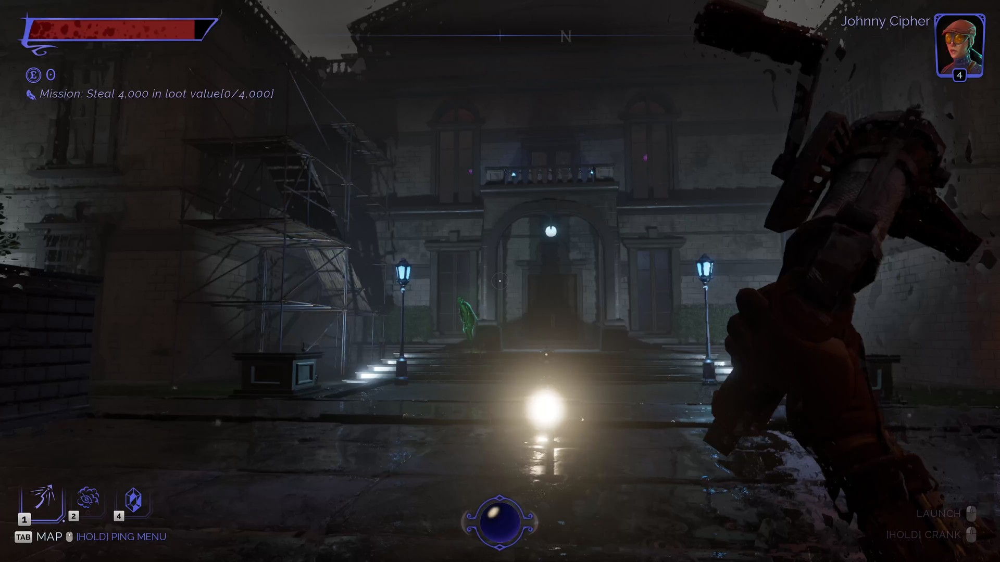

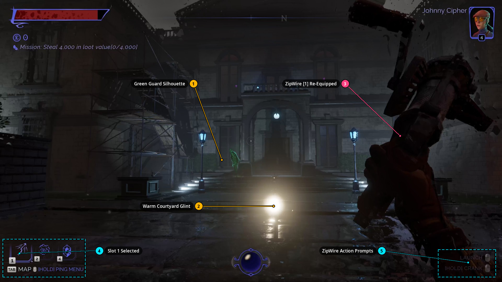

| # | Category | Code | Label | Target (x, y) | Observed UE5 Detail | TAT-2 Ref |
|---|---|---|---|---|---|---|
| 1 | Visual | V5 | Green Guard Silhouette | (848, 612) | Highlighted constable silhouette under the portico transitions from RED to bright GREEN at 02:33.00. | -- |
| 2 | Visual | V1 | Warm Courtyard Glint | (1046, 789) | Bright warm golden glint/flare reflects off the rain-wet courtyard flagstones center-frame. | -- |
| 3 | Gameplay/Audio | G3 | ZipWire [1] Re-Equipped | (1530, 520) | Player switches back from Vistara Diamond [4] to ZipWire [1] mechanical crank launcher (02:32.80-02:33.00). Vistara shimmer decay plus ZipWire re-equip click (02:34.0, pk -28.2 dBFS); no BGM. | -- |
| 4 | HUD/UI | UI3 | Slot 1 Selected | (74, 970) | Bottom-left hotbar switches active white border highlight back to slot [1] Zipwire. | -- |
| 5 | HUD/UI | UI2 | ZipWire Action Prompts | (1790, 1005) | Bottom-right tool prompts update to 'LAUNCH [LMB]' above '[HOLD] CRANK [RMB]' for the re-equipped ZipWire. | -- |

### KF23 - side_wing_macleod_sign
(02:41.00, S20)

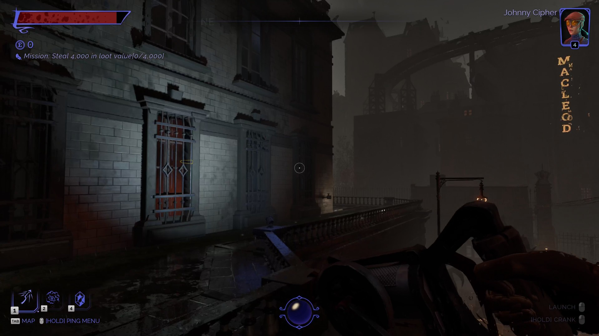

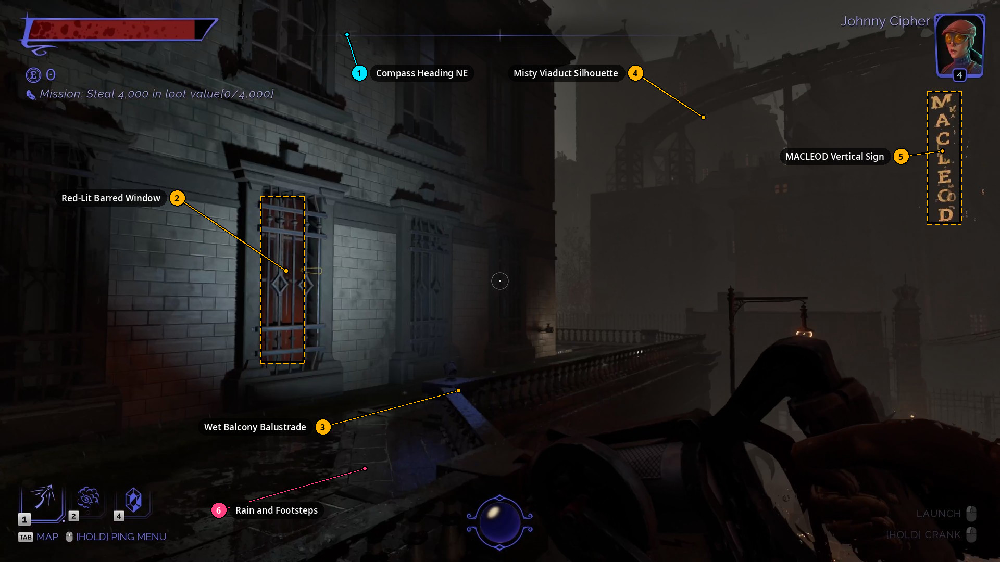

| # | Category | Code | Label | Target (x, y) | Observed UE5 Detail | TAT-2 Ref |
|---|---|---|---|---|---|---|
| 1 | HUD/UI | UI3 | Compass Heading NE | (666, 66) | Top-center compass bar displays 'NE' heading tick above the side-wing balcony traversal. | -- |
| 2 | Visual | V4 | Red-Lit Barred Window | (549, 520) | Stone side-wing facade features ornate diamond iron window grilles glowing warm red from an interior light source. | -- |
| 3 | Visual | V4 | Wet Balcony Balustrade | (880, 750) | Rain-slick stone balcony pavers and carved stone balustrade reflecting cool moonlight beside wet stone footsteps (02:34-02:41). | -- |
| 4 | Visual | V2 | Misty Viaduct Silhouette | (1350, 225) | Elevated steel railway/bridge arch and distant Kilcairn rooflines receding into volumetric night fog. | -- |
| 5 | Visual | V1 | MACLEOD Vertical Sign | (1809, 290) | Crisp illuminated vertical gold serif 'MACLEOD' signage mounted on the distant right-hand brick facade. | -- |
| 6 | Gameplay/Audio | AU1 | Rain and Footsteps | (700, 900) | Steady rain on wet stone balcony plus rapid wet footstep bed and ZipWire re-equip click (02:34.0, pk -28.2 dBFS); distant guard throat-clear follows at 02:41.5; no BGM. | -- |

### KF24 - locked_blue_double_doors
(03:00.60, S21)

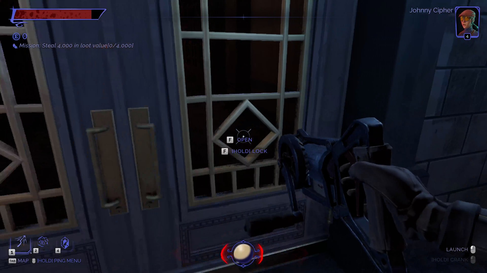

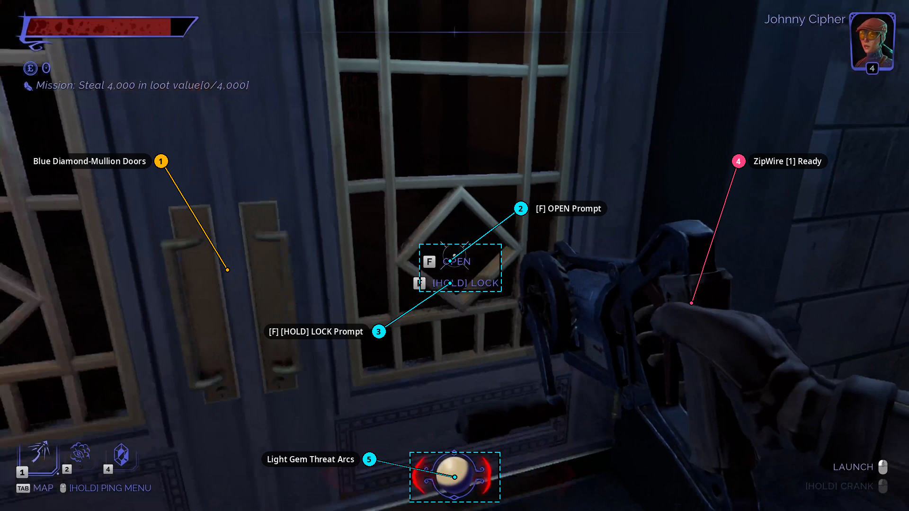

| # | Category | Code | Label | Target (x, y) | Observed UE5 Detail | TAT-2 Ref |
|---|---|---|---|---|---|---|
| 1 | Visual | V4 | Blue Diamond-Mullion Doors | (480, 570) | Blue-painted wooden double doors with diamond-mullion glass panes and twin vertical brass pull handles. | -- |
| 2 | HUD/UI | UI2 | [F] OPEN Prompt | (950, 551) | Center reticle displays '[F] OPEN' prompt prior to door latch click and wooden creak open at 03:01.0-03:02.2 (pk=-29.8 dBFS). | -- |
| 3 | HUD/UI | UI2 | [F] [HOLD] LOCK Prompt | (950, 598) | Stacked secondary prompt '[F] [HOLD] LOCK' beneath '[F] OPEN' on the unlocked portico entrance doors. | -- |
| 4 | Gameplay/Audio | G3 | ZipWire [1] Ready | (1460, 640) | 1P gloved hand grips the ZipWire [1] launcher in foreground while sheltered portico reduces exterior rain wash. | -- |
| 5 | HUD/UI | UI5 | Light Gem Threat Arcs | (960, 1008) | Bottom-center Light Gem glows bright pale-gold flanked by twin red directional threat/noise arcs. | -- |

### KF25 - parlor_pickpocket_takedown
(03:16.80, S22)

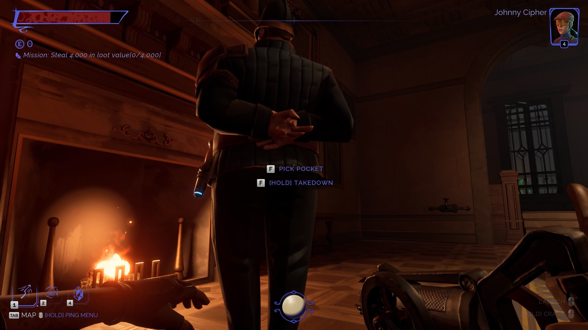

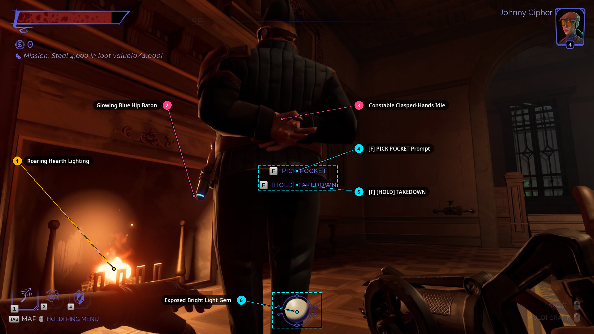

| # | Category | Code | Label | Target (x, y) | Observed UE5 Detail | TAT-2 Ref |
|---|---|---|---|---|---|---|
| 1 | Visual | V1 | Roaring Hearth Lighting | (368, 869) | Roaring parlor fireplace casts warm amber radial light and crackle ambience (-61 to -55 dBFS) across wood-parquet floor. | -- |
| 2 | Gameplay/Audio | G4 | Glowing Blue Hip Baton | (626, 633) | Patrolling constable carries an illuminated glowing-blue-tip baton holstered on his left belt hip. | -- |
| 3 | Gameplay/Audio | G4 | Constable Clasped-Hands Idle | (910, 385) | Standing constable faces fireplace with hands clasped behind back, unaware of crouched stealth approach. | -- |
| 4 | HUD/UI | UI2 | [F] PICK POCKET Prompt | (960, 552) | Center reticle displays '[F] PICK POCKET' just 0.30s prior to Guildhall Key pickup chime at 03:17.10 (pk=-23.6 dBFS). | -- |
| 5 | HUD/UI | UI2 | [F] [HOLD] TAKEDOWN | (960, 597) | Stacked contextual prompt '[F] [HOLD] TAKEDOWN' beneath '[F] PICK POCKET' when crouched directly behind guard. | -- |
| 6 | HUD/UI | UI3 | Exposed Bright Light Gem | (960, 1008) | Light Gem glows bright white-gold from nearby hearth firelight without red alert arcs. | -- |

### KF26 - parlor_guard_takedown
(03:20.20, S23)

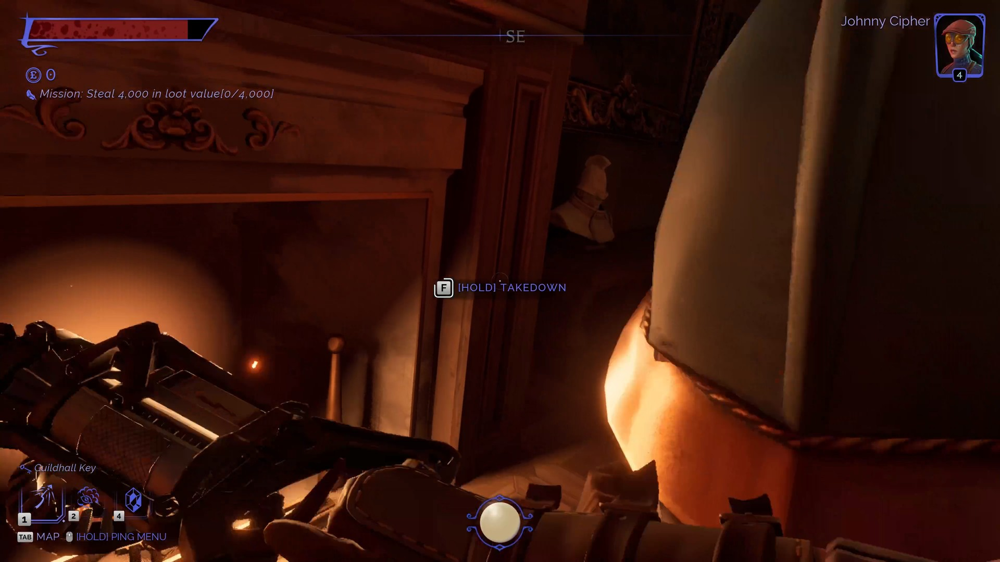

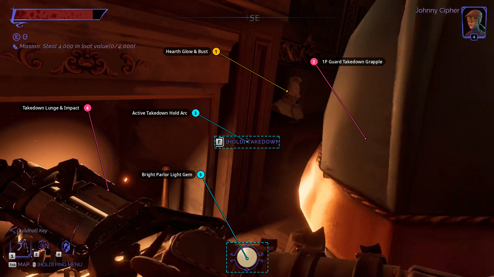

| # | Category | Code | Label | Target (x, y) | Observed UE5 Detail | TAT-2 Ref |
|---|---|---|---|---|---|---|
| 1 | Visual | V1 | Hearth Glow & Bust | (1115, 355) | Warm fireplace light illuminates the carved mantel and classical bust behind the tilted 1P takedown camera. | -- |
| 2 | Gameplay/Audio | G4 | 1P Guard Takedown Grapple | (1420, 540) | 1P camera tilts closely over the constable's helmet and corded shoulder during the melee knockdown sequence (03:17.80-03:20.60). | -- |
| 3 | HUD/UI | UI5 | Active Takedown Hold Arc | (960, 552) | Center '[F] [HOLD] TAKEDOWN' prompt displays an active circular hold-progress arc around the reticle. | -- |
| 4 | Gameplay/Audio | AU5 | Takedown Lunge & Impact | (420, 740) | 1P gloved hands & ZipWire [1] lunge forward alongside grapple grunts (03:18.8-03:19.7) and blunt KO thud + groan (03:20.6-03:21.5, pk=-22.1 dBFS). | -- |
| 5 | HUD/UI | UI3 | Bright Parlor Light Gem | (960, 1008) | Light Gem remains illuminated bright pale-gold against the dark 1P forearm during takedown. | -- |

### KF27 - foyer_security_beam
(03:27.60, S24)

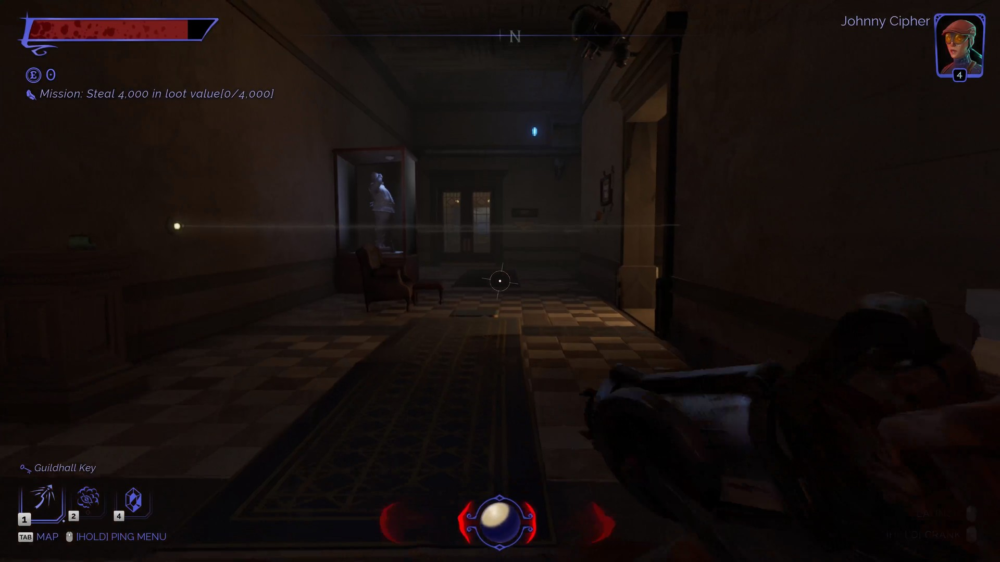

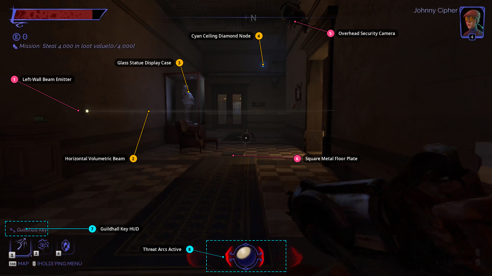

| # | Category | Code | Label | Target (x, y) | Observed UE5 Detail | TAT-2 Ref |
|---|---|---|---|---|---|---|
| 1 | Gameplay/Audio | G5 | Left-Wall Beam Emitter | (305, 432) | Mid-height circular glowing white beam emitter mounted on the left marble foyer wall (~40% height). | -- |
| 2 | Visual | V6 | Horizontal Volumetric Beam | (580, 435) | Crisp horizontal white volumetric security beam spanning wall-to-wall across the checkered marble foyer. | -- |
| 3 | Visual | V4 | Glass Statue Display Case | (735, 358) | Tall internally lit glass display vitrine housing a bust/statue beside a velvet armchair and ottoman. | -- |
| 4 | Visual | V6 | Cyan Ceiling Diamond Node | (1026, 252) | Glowing cyan diamond security/junction node mounted high above the far foyer double doors. | -- |
| 5 | Gameplay/Audio | G5 | Overhead Security Camera | (1151, 84) | Rotating overhead security camera/spotlight housing mounted high on the right foyer wall above the Basement Stairs doorway. | -- |
| 6 | Gameplay/Audio | G1 | Square Metal Floor Plate | (910, 608) | Flush square metallic pressure/junction plate embedded in the checkered marble floor ahead of the carpet runner. | -- |
| 7 | HUD/UI | UI3 | Guildhall Key HUD | (104, 895) | Pickpocketed 'Guildhall Key' icon and label persist in the bottom-left HUD directly above slot [1] Zipwire. | -- |
| 8 | HUD/UI | UI5 | Threat Arcs Active | (870, 1005) | Outer twin red directional threat/noise arcs pulse around the lit Light Gem during marble footstep approach (pk=-28.9 dBFS). | -- |

### KF28 - foyer_arcane_barriers
(03:35.00, S25)

| # | Category | Code | Label | Target (x, y) | Observed UE5 Detail | TAT-2 Ref |
|---|---|---|---|---|---|---|
| 1 | Visual | V6 | Sweeping Security Beam | (420, 547) | White volumetric security beam projecting from the left wall into the triggered foyer ward barrier. | -- |
| 2 | Visual | V6 | Purple Crystalline Ward | (870, 360) | Bright faceted purple crystalline arcane barrier sealing the main foyer archway after crossing the beam at 03:29.00 (ward hum -59 dBFS). | -- |
| 3 | Gameplay/Audio | G1 | Basement Stairs Plaque | (1214, 603) | Framed 'Basement Stairs' wall plaque mounted immediately left of the vine-sealed side stairwell doorway. | -- |
| 4 | Gameplay/Audio | G5 | Overhead Security Camera | (1400, 435) | Rotating overhead security camera/spotlight above the Basement Stairs doorway sweeping across the foyer. | -- |
| 5 | Visual | V6 | Green Arcane Vine Lock | (1331, 599) | Glowing green thorny arcane vines erupting across the Basement Stairs doorway upon beam tripwire trigger. | -- |
| 6 | HUD/UI | UI5 | Jaw-Trap Status Icon | (939, 808) | White circular mechanical jaw/bear-trap icon with active countdown ring appearing above Light Gem from 03:29.00+. | -- |
| 7 | HUD/UI | UI5 | Unconscious Guard Icon | (992, 805) | Orange-arc unconscious-head ('xx' eyes + 'zz' + '>>') circular status icon active above Light Gem from 03:31.20+. | -- |

### KF29 - stairs_crimson_alarm
(03:39.40, S26)

| # | Category | Code | Label | Target (x, y) | Observed UE5 Detail | TAT-2 Ref |
|---|---|---|---|---|---|---|
| 1 | Visual | V4 | Unlit Slate Stair Treads | (1080, 120) | Upper staircase treads remain plain dark grey/slate outside the sweeping crimson alarm spotlight cone. | -- |
| 2 | Visual | V1 | Crimson Alarm Spotlight | (1220, 540) | Wall security spotlight bathes the dark grey/slate treads in intense crimson alarm light (03:38.20-03:39.60) post-barrier shatter (pk=-23.5 dBFS). | -- |
| 3 | HUD/UI | UI2 | CRANK [LMB] Reticle | (960, 550) | Six-tick circular center reticle displays 'CRANK [LMB]' prompt during rapid staircase ascent. | -- |
| 4 | HUD/UI | UI5 | Re-Triggered Jaw-Trap Icon | (960, 808) | 3rd status-icon event: re-triggered white mechanical jaw-trap icon with partial countdown arc above Light Gem (03:38.07-03:41.87). | -- |
| 5 | Gameplay/Audio | G3 | Crimson-Lit ZipWire [1] | (720, 880) | 1P ZipWire [1] launcher and gloved hand receive crimson spotlight + brief blue/purple highlight while ascending (ZipWire clack pk=-24.5 dBFS). | -- |

### KF30 - pause_menu
(03:43.20, S27)

| # | Category | Code | Label | Target (x, y) | Observed UE5 Detail | TAT-2 Ref |
|---|---|---|---|---|---|---|
| 1 | Visual | V7 | Teal/Copper Art-Nouveau Frame | (680, 350) | Centered Pause Menu modal framed with curved teal/copper Art-Nouveau corner filigree over darkened blurred gameplay backdrop. | -- |
| 2 | HUD/UI | UI1 | Pause Action Buttons | (776, 565) | Four centered vertical menu items: 'RESUME', 'SETTINGS', 'RETURN TO THIEF'S DEN' (straight apostrophe), and 'QUIT TO DESKTOP'. | -- |
| 3 | HUD/UI | UI5 | QUIT TO DESKTOP Hover | (1070, 682) | Clean single cursor hovers 'QUIT TO DESKTOP' at 03:43.20 (prior to 03:43.70+ multi-cursor trail), matching UI hover/click at 03:43.2-03:43.6 (pk=-34.2 dBFS). | -- |
| 4 | Gameplay/Audio | AU4 | -19 dB Ambience Ducking | (1240, 455) | Opening Pause Menu at 03:41.90 ducks gameplay ambience by -19 dB (-53 dBFS to -72.4 dBFS), followed by digital silence (-240 dBFS) after quit. | -- |
| 5 | HUD/UI | UI1 | Build & Seed Footer | (158, 1052) | Bottom-left build/difficulty/seed footer reads '1.5.148559   Novice   1025051536'. | -- |
