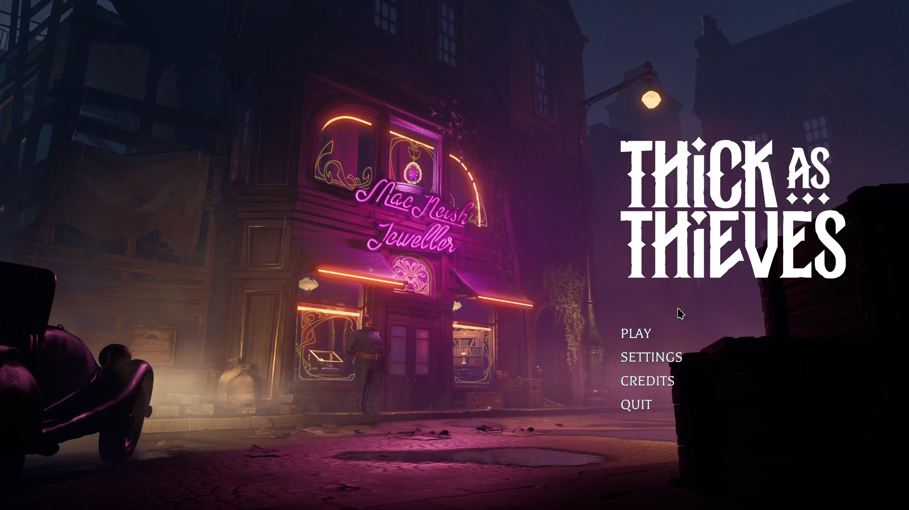
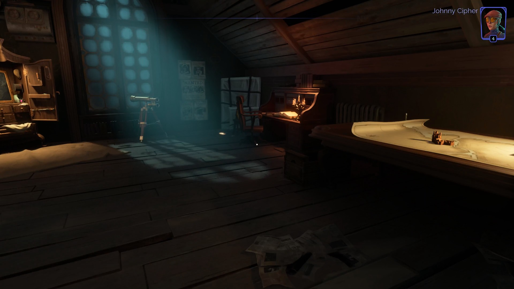
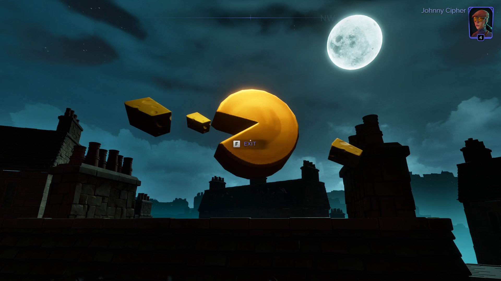
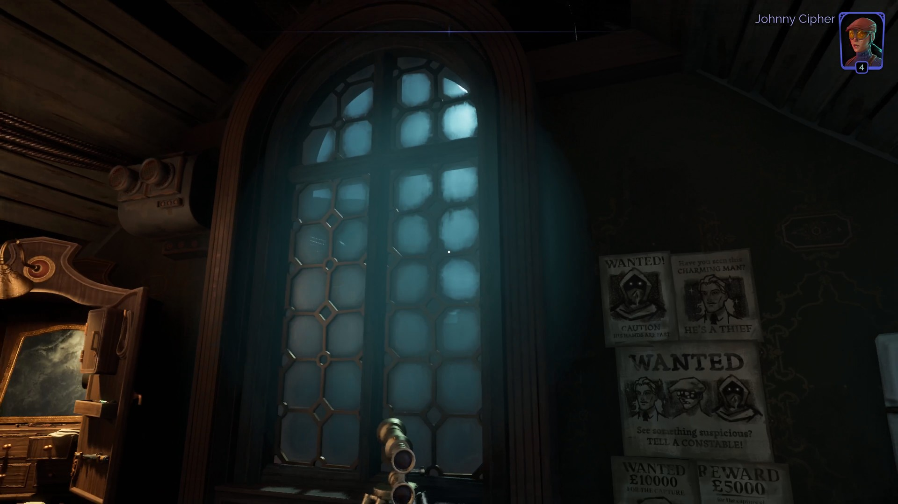
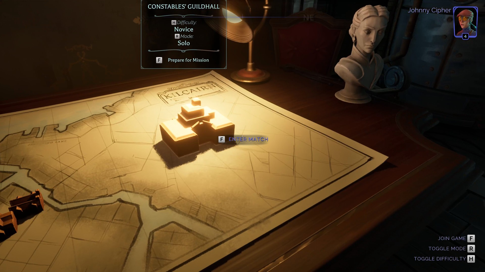
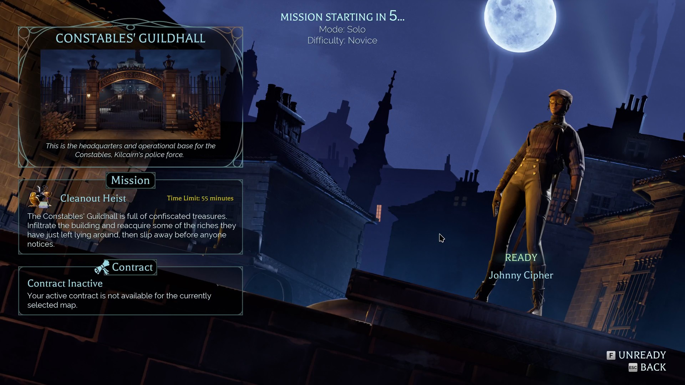
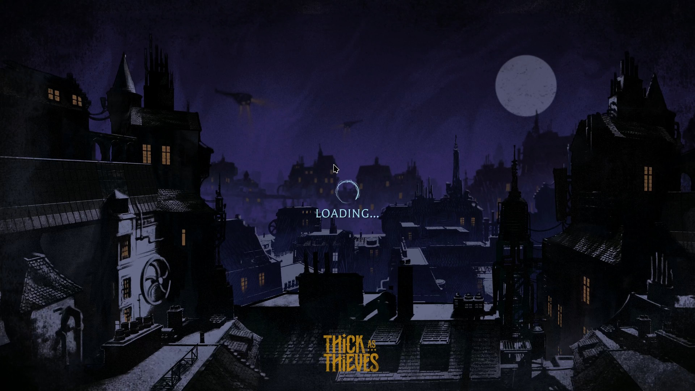
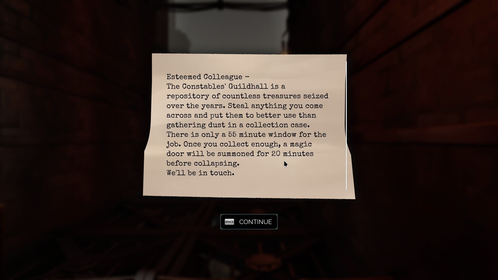
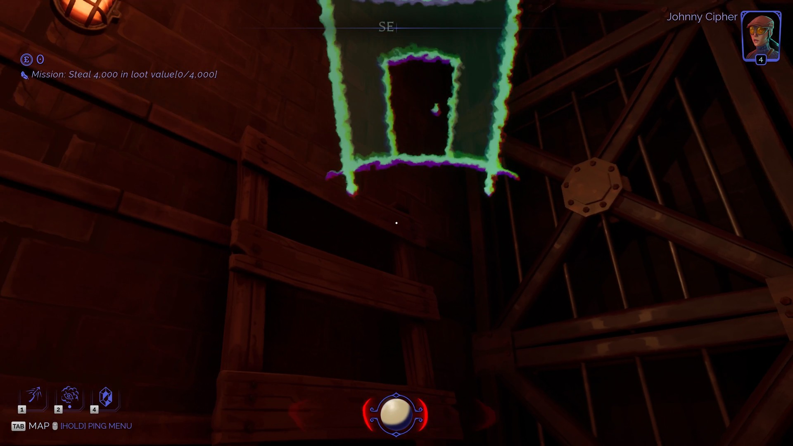
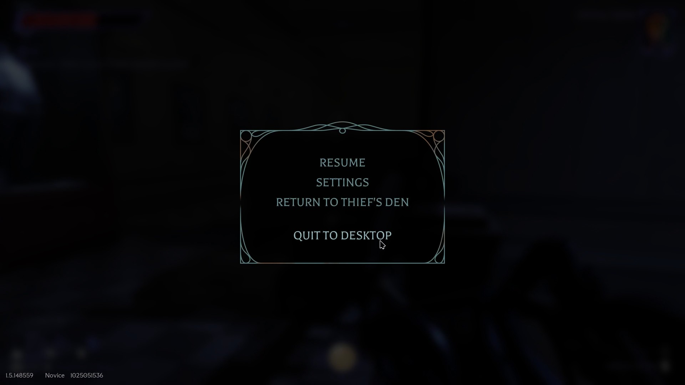

# Port Comparison Scorecard — recorded run 2026-11-24 vs official `clip_1,795,033,698,901`

Filled scorecard for the 281 s port recording, against the 30-keyframe official clip. Section 2 is a
1:1 mirror of `docs/REFERENCE_BASELINE.md` §8 — same rows, same order, all 120 (Visual 37, Audio 31,
HUD/UI 27, Gameplay 25). Only **Port observation** and **Score** are new. The template's **Notes**
column (pre-stated caveats) is omitted; where a caveat applies it is cited inside the Port
observation. Official observations are copied from the template row for row; ids and order are unchanged.

**The run.** `$HOME/Videos/2026-11-24 22-47-16.mp4` — 281.333 s, 3840×2160 @ 30 fps, 8 440
frames, h264 8.08 Mbit/s, AAC 48 kHz. Client area 3840×2090 (70 px title bar cropped). Session log
`~/.local/share/godot/app_userdata/Thick As Thieves 2/logs/godot2026-11-24T22.47.10.log` (168 lines,
ends `TAT-2 mission_ready map=guildhall meshes=62950`). One deployment: `Mission.Guildhall.LootTheRoom`,
contract `Contract.Main.2` (*Into the Lion's Den*), Novice, solo, `free_play=false` (F1b C-1, C4-01).

**Port frame convention.** `build/qa/review_20261124/frames_client/f_NNNN.jpg` = **t = NNNN − 1 s**,
3840×2090 (title bar removed). All port times below are `t=mm:ss` in that convention. L4's timestamps
are ≈`NNNN − 0.5 s`; where L4 is the only source, the frame id is given so the event is unambiguous.

**Sources and precedence.** The score is taken, in order, from (1) `docs/reference/clip_1795033698901/ADJUDICATIONS.md`
and the two adjudication files, (2) the owning lane's verdict table (L1 = V1/V2/V7, L2 = V3–V6,
L3 = UI*, L4 = G*, L5 = AU*), (3) a measurement another lane made that resolves an owning lane's
`UNVERIFIED` where the limitation was instrumental (1 fps) rather than factual, (4) `UNVERIFIED` with
the reason. Lane tokens map as: `MATCH`→`PASS`, `PARTIAL`/`DELTA`→`DELTA`, `FAIL`→`MISSING` when the
row's subject is absent or non-functional (otherwise `DELTA`), `N/A-route`/`N/A-sample`→`N/A-route`,
`HARD_LIMIT`→`HARD_LIMIT`. Where a lane scored an *analogous* element rather than the row's own subject
(L1's V1-06 globe sconce for the hearth, L2's V5-02 prep avatar for the wardrobe turntable), the row is
set `N/A-route` and the substitution is stated in the observation; where half the row remains testable
it is `UNVERIFIED` (AU5-07's acquisition chime).

**Score vocabulary.** Exactly `PASS` / `DELTA` / `MISSING` / `HARD_LIMIT` / `N/A-route`, plus
`UNVERIFIED` as a coverage marker (not a score). `N/A-route` always carries the absence proof: the
official `Snn`/`KFnn` needed and why this 281 s run never reaches it (cross-referenced to
`kf_presence.md`). Rows were not dropped or merged. Where lanes disagree and the adjudicator did not
settle it, the owning lane is used, or `UNVERIFIED` with the named experiment — never a guess.

**Provenance (Phase 0a, 2026-11-27).** `ADJUDICATIONS.md` and `row_route_matrix.md` were moved from
the git-ignored `build/qa/review_20261124/` into this reference directory and are now tracked. The
2026-11-24 recording (`$HOME/Videos/2026-11-24 22-47-16.mp4`) and its 281 frames
(`build/qa/review_20261124/frames_client/`, `frames_1080/`, `frames_4k/`) remain **outside git** —
they are private capture media, not committed; the image slots in §3 are private-local links. Only
the scorecard and the two provenance documents are tracked.

**What this run is not.** It is a different route from the official clip: no NPC of any kind, no
smoke bomb, no vintage car, no Vistara Diamond, no escape/endgame, no foyer beam, no crimson alarm. It
does contain a ZipWire (launch 02:01, crank 02:12–02:19) — L5's "no zipwire" is retracted below — and
the telescope Easter egg. 56 of 120 rows are therefore `N/A-route`; read §5 before quoting any tally.

## 1. Scoring rules (verbatim from `docs/REFERENCE_BASELINE.md` §8)

Scoring rules: fill **Port observation** from the aligned port recording, then set **Score** to exactly one of:

- `PASS` — port matches the official observation (within the tolerance noted in the row).
- `DELTA` — element present in both but visibly/audibly different.
- `MISSING` — element absent or non-functional in the port.
- `HARD_LIMIT` — difference caused by an unrecoverable cooked-data limit (cite the `HL-n`).
- `N/A` — not applicable or not observable on this route.

This scorecard writes the last token as **`N/A-route`** (the review's vocabulary) and adds
`UNVERIFIED`, which is not a score: it marks a row the run reaches but the evidence cannot settle.

## 2. 4-pillar comparison checklist (V1–V7, AU1–AU6, UI1–UI5, G1–G5)

Subsections keep their §8 numbering; rows are copied in source order.

### 8.1 Visual (V1–V7)

| ID | Criterion | Reference (Snn / KFnn #k) | Official observation | Port observation | Score |
|---|---|---|---|---|---|
| V1-01 | Neon flicker + amber practicals | S01 / KF01 #1 | Magenta cursive `Mac Neish` / `Jeweller` flickers (dim `00:00.10`, full-lit `00:01.00`, left half off `00:02.05`) over warm amber window/awning bars. | Neon and amber practicals present and hue-matched (awning tube 204.8/88.8/96.1 vs KF01 183.6/76.5/103.5, L1 §4.6); the neon ROI modulates only ~18 % over t=1–8 s and no left-half-off frame appears in 8 samples (L1 §4.5). Sub-second states cannot be excluded at 1 fps. | DELTA |
| V1-02 | Volumetric moon shaft vs candle pools | S03 / KF02 #1 | Teal-cyan moonlight shaft through arched frosted window casting mullion shadows across dark floorboards; warm candle pool at the desk contrasts. | Teal leaded window with volumetric haze, mullion shadows and a warm desk-lamp pool are present; Den `p50 17` matches KF02's 18, but the black floor sits on 8 (`p10 = 8`, 0.8 % < 8 vs 11.4 %) and `p99 97` vs 153 — no shadow-toe/GI separation; milky haze in the shaft (L1-10). | HARD_LIMIT |
| V1-03 | Banker's-lamp pool on the map | S08 / KF10 #4 | Warm directional brass banker's-lamp pool across `KILCAIRN` parchment and wooden token vs cool moonlit Den. | Brass globe lamp lit (globe `max 241`) and the parchment is the brightest surface, but the frame reaches only `p95 131–144` vs KF10 197, and 0.26–0.40 % of pixels > 200 vs 5.9 % (L1-11). Framing differs (port camera stands back; KF10 is a scripted close-up). | DELTA |
| V1-04 | Lantern bounce & streetlamp exposure | S12 / KF14 #2; S13 / KF15 #2 | Caged wall lantern casts warm orange bounce on brick after ignite `01:15.1`; teal-cyan bulkhead + green streetlamp pools; gem flares pale gold under streetlamps. | Streetlamps and a lit doorway read on wet ground, and an interior wall sconce exists at 03:06; the nearest cast-iron courtyard lamp head is **unlit** (140×140 native: mean 23.1, max 48.8) against a wall at 15.7, so no warm bounce, and there is no lantern-ignite beat (no `[F] TURN ON`) (L1-03, L1 §V1-04). | DELTA |
| V1-05 | Flashing car-headlight glare | S13–S14 / KF16 #3 | Dual vintage-car headlights flash across wet cobbles (`01:36.38+`) with specular streaks raking the gate. | Not reached. No car exists in any frame; the street at 01:45–02:00 has a hand cart only. Needs S13–S14 / KF16 #3; KF16 is ABSENT (`kf_presence.md` KF16: no arch, no guard, no car, no headlights). | N/A-route |
| V1-06 | Hearth amber radial pool | S22 / KF25 #1 | Roaring parlor fireplace casts warm amber radial light across herringbone parquet; chandelier points overhead. | Not reached. The run never enters the parlor/hearth room; KF25 is ABSENT (no parlor, no fireplace, no constable — `kf_presence.md`). A warm globe-sconce pool exists in a lit interior at t≈04:15, but a hearth is a different subject; L1 scored that substitute DELTA and is not followed here. | N/A-route |
| V1-07 | Crimson alarm spotlight wash | S26 / KF29 #2 | Wall security spotlight bathes slate treads + 1P arms in intense crimson (`03:38.20–03:39.60`); unlit slate stays plain outside the cone. | Not reached. No alarm state and no slate stairwell exist; KF29 is ABSENT. The only crimson in the run is the HUD's player-noise arcs. Needs S26 / KF29 #2. | N/A-route |
| V2-01 | Night rain streaks + puddle reflections | S01 / KF01 #5; S13 / KF15 #6 | Diagonal rain streaks over rain-slick cobbles; foreground puddle reflects magenta/amber neon. | Rain present at both ends (startscreen, street) but drawn as thick 4–8 px near-vertical dashes ~200 px long, not fine diagonal streaks; the startscreen forecourt bounce is half the reference and violet-tinted (R 52.6 / G 26.7 / B 46.1 vs KF01 112.9 / 74.3 / 71.9) with no puddle specular (L1-12, L1-14). | DELTA |
| V2-02 | Telescope sky, moon & cheese easter egg | S05 / KF05 #1–#3 | Cloudy teal-blue night sky, faint stars, crater-textured full moon; giant rotating golden cheese wedge with 3 orbiting chunks over rooftops. | `f_0023`: cloudy teal-grey sky, faint stars, marbled full moon, pale-gold cheese wedge with 3 orbiting chunks over black rooftop silhouettes; sky cut 22.1–23.2 s (L1 §V2-02, `kf_presence.md` KF05, F1a C-3). | PASS |
| V2-03 | Loading illustration sky | S02; S10 / KF12 #1–#2 | Dark-indigo illustrated skyline, twin dirigibles with yellow searchlight cones, textured pale moon upper-right. | Same art: frame mean 20.6 / 20.6 / 20.5 at t=11/54/90 vs official 20.1, `p50 14` both, `p95 73` vs 71, `>200` 0.03 % vs 0.00 %. Both dirigibles, cones, moon and gold emblem present (L1 §1.2, `kf_presence.md` KF12). | PASS |
| V2-04 | Volumetric night-mist depth | S15 / KF17 #2; S20 / KF23 #4 | Clocktower silhouette with red window accents in mist; steel viaduct arch and rooflines receding into fog. | Rooftop haze present (sky band 35.3 vs KF17 46.0 / KF18 37.7) but sitting on a 47.7 %-black frame, so the depth gradient is compressed; no clocktower with red window accents and no steel viaduct arch in any frame (L1 §V2-04). | DELTA |
| V2-05 | Rain fade-in after digital silence | S10 / KF12 #5 | True digital silence `01:04.94–01:07.78`, then night rain fades in from `01:07.7757` (first non-zero sample). | **Not measurable in this capture.** Both halves are capture-audio claims: L5's "no silence" and "no rain fade-in" are void because T03-AUDIO shows the bed is OBS-borne. The visual cut itself is clean (L1 §4.1); the audio transition was not measured. Missing evidence (W9-P0): an in-engine master-bus capture (`AudioEffectCapture` on Master, 48 kHz) across 01:04.94–01:07.78 and the rain return; the visual cut is confirmed. | UNVERIFIED |
| V3-01 | Wet-cobble specular | S13 / KF15 #2 | Rain-wet cobbles with puddle speculars under the teal-cyan bulkhead light and streetlamps. | Authored cobble albedo and normal read (stone joints and blocks visible), but no wet specular, no puddle and no sky/neon reflection in the sampled courtyard; the ground reads matte beige (L2-10). One viewpoint only. | DELTA |
| V3-02 | Emissive faceted diamonds | S07 / KF09 #5–#6 | Emissive green floor diamond + iridescent white-blue table diamond under the candelabra. | Not reached. The S07 gramophone/candelabra corner is never visited (KF09 ABSENT) and no emissive green floor diamond or table diamond appears in any Den frame (L2 §5, "N/A-sample"; `kf_presence.md` KF09). | N/A-route |
| V3-03 | Blue door paint, mullions & brass | S21 / KF24 #1 | Blue-painted wood, white/cream diamond-mullion grid over dark glass panes, twin vertical brass pull handles. | Not reached. Every door touched is a dark-timber interior leaf with a brass handle (f_0172) or a black iron gate; no blue paint, cream diamond mullions or twin brass pulls anywhere. KF24 is PARTIAL on the *prompt* pair only; the blue-door art is ABSENT (`kf_presence.md` KF24). | N/A-route |
| V3-04 | Purple shopfront orb | S01 / KF01 #2 | Glowing purple egg/orb in the upper Art Nouveau shop display beneath the warm streetlamp. | Orb present with the right hue but flat and non-emissive: `#7827AA`, mean 0.352, sd 0.092, no bloom (L2 §5, f_0005 crop `120x120+1700+650`). L1 called it PASS; the owning lane's measurement is used. | DELTA |
| V4-01 | Startscreen street dressing | S01 / KF01 #4–#5 | Stationary idle guard in uniform/helmet/brown belt; vintage car rear fender; wooden crates; Art Nouveau gold scrollwork storefront. | Guard, car fender, crates and gold scrollwork all in frame and in the right places, but the guard reads as an unlit dark silhouette (no helmet/belt detail) and the car rear panel is pale/flat (L2 §5, f_0005). L1 scored PASS; the owning lane's PARTIAL is used. | DELTA |
| V4-02 | Den attic dressing | S03 / KF02 #5–#6 | Candlelit rolltop desk, open armoire, `KILCAIRN` map table, scattered newspapers on floorboards, rafters. | Rolltop desk with globe lamp, armoire, `KILCAIRN` map table with parchment and tokens, rafters and the poster wall all present and textured (L1 §V4-02, L2 §3). The scattered floor newspapers are not in this framing, which is a framing limit, not a visible difference. | PASS |
| V4-03 | Wanted poster wall | S05 / KF06 #5 | Five framed posters verbatim: `WANTED! / CAUTION / HIS HANDS ARE FAST`; `CHARMING MAN? / HE'S A THIEF`; `TELL A CONSTABLE!`; `WANTED £10000`; `REWARD £5000`. | Five posters in frame with legible world text: `CAUTION / HIS HANDS ARE FAST`, `HE'S A THIEF`, `TELL A CONSTABLE!`, `WANTED £10000`, `REWARD £5000`, plus `SPIDER` / `THE HOOD` (L1 §V4-03, `kf_presence.md` KF06). L2's PARTIAL refers to a different, floor-lying sign (L2-07) and is not this row. | PASS |
| V4-04 | `BARRON'S DEMOLITION` alley dressing | S13 / KF15 #1, #3 | Weathered brick banner + faint `EST. 1865` + `Out with the old, in with the new!`; crates, fallen steel drums, ladder, alley weeds. | Rain-slick street with crates, hand cart, stone wall and iron fence; a large **blank white wall sign with a horizontal seam** occupies the banner site (f_0121), but no `BARRON'S DEMOLITION` / `EST. 1865` / `Out with the old…` lettering, no oil drums, no ladder and no car (`kf_presence.md` KF15 PARTIAL). Both L1 and L2 called the row N/A-route; the alley and the banner surface are present, so it is a delta. | DELTA |
| V4-05 | Gate arch, griffins & gear plate | S14 / KF16 #1; S17 / KF18 #2, #4 | Wrought-iron `CONSTABLE'S GUILDHALL` arch with crowned star-topped pillars; twin stone griffins on brick pedestals; 10-bolt white gear plate with red downward `⚡` arrow. | Not reached. After spawn the run stays on a street/perimeter wall (t=01:49: unlettered stone wall, iron fence, gate pillar) then rooftops and interiors; no arch lettering, griffins or gear plate. KF16 and KF18 are ABSENT (`kf_presence.md`). | N/A-route |
| V4-06 | `MACLEOD` vertical sign | S20 / KF23 #5 | Crisp illuminated vertical gold serif sign on the distant right facade (`02:35.00–02:41.50`, again `02:48.50–02:49.00`). | Not reached. No exterior side-wing facade after spawn; t=02:41 is an interior `DOOR LOCK (LV 3)` overlay. KF23 is ABSENT (`kf_presence.md`). | N/A-route |
| V4-07 | Foyer dressing | S24 / KF27 #2; S25 / KF28 #3 | Tall lit glass statue vitrine, velvet armchair + ottoman, flush square metallic floor plate; framed `Basement Stairs` and `WC` plaques. | Checkered black/white marble hall with columns, a shrine and white busts (f_0174), a glass-cased white `Cat Statue` on a blue cushion (f_0208), and later a backlit glass display case with a statue inside plus two busts on plinths (f_0267); no velvet armchair/ottoman, no flush floor plate and no `Basement Stairs`/`WC` plaques (`kf_presence.md` KF27 PARTIAL). L2 called it N/A-route ("never reaches the foyer"); the vitrine-and-marble dressing is present, so it is a delta. **Corrected in W9-P1**: the earlier "no velvet armchair/ottoman" clause is false. `build/qa/w9/captures/p1_before_foyer_sweep_yaw180.png` (Vulkan 1920×1080, authored upper-foyer slot turned 180°, `TAT2_AO=on`) shows a tufted armchair with a red ottoman, the white marble-topped vitrine, a framed picture on it, columns, an archway and a bust on a plinth. What is still absent is the flush square metallic floor plate and the `Basement Stairs`/`WC` plaques, so the row stays a delta. | DELTA |
| V5-01 | Idle guard at shopfront | S01 / KF01 #4 | Stationary guard in dark uniform, helmet, brown belt before the `Mac Neish` shopfront. | Guard stands in the correct place at the shopfront doors, but renders as a dark unlit silhouette; helmet and belt are not readable (L2 §5, f_0005). L1 scored PASS; the owning lane's PARTIAL is used. | DELTA |
| V5-02 | 3D Spider turntable with cap sync | S04 / KF03 #4; KF04 #4 | Spider with bowler hat, yellow goggles, purple sweater on turntable before open armoire; `Cap` equipped by KF04, `Head` thumbnail synced. | Not reached. The wardrobe overlay never opens; no turntable, `Edit Loadout` panel, cap sync or tooltip card appears (KF03/KF04 ABSENT, `kf_presence.md`; L2 §5 N/A-route). L2's P1 `FAIL` scores the **prep-stage avatar**, a different screen — carried under UI4-03/L2-08, not here. | N/A-route |
| V5-03 | 1P gloved hands + ZipWire viewmodel | S12 / KF14 (vault); S21 / KF24 #4 | 1P gloved arms brace the railing vault (`01:19.6`); ZipWire `[1]` launcher gripped in right hand at the portico. | Launcher, checkered barrel shroud and brass cuff piping read correctly; the forearm/glove is a flat orange-tan surface with no leather grain, stitching or finger separation and is brighter than the tool (L2-09). The vault half (S12) has no counterpart. | DELTA |
| V5-04 | Constable idle + blue hip baton | S22 / KF25 #2–#3 | Standing constable faces the fireplace, hands clasped behind back, glowing blue-tip baton on left hip; unaware of the crouched approach. | Not reached. No constable — no NPC of any kind — in any frame (L2 §4, `kf_presence.md` KF25 ABSENT). | N/A-route |
| V5-05 | Takedown grapple pose | S23 / KF26 #2 | 1P camera lunges/tilts closely over the constable's helmet and corded shoulder; guard knocked onto the parquet; pull-back to eye height. | Not reached. No grapple, no `[F] [HOLD] TAKEDOWN`, no KO; KF26 is ABSENT (`kf_presence.md`). | N/A-route |
| V6-01 | Escape portal wall outline | S12 / KF14 #1 | Jagged glowing emerald-green + violet chromatic-edge outline shimmering on the safe-room wall (`01:15.2–01:16.2`). | Not reached. No escape portal is summoned and the run ends in a pause menu; the safe-room wall at t=01:41 shows a blue-white oval sconce with a mullion pattern, not the jagged green/violet outline (KF14 PARTIAL, `kf_presence.md`). | N/A-route |
| V6-02 | Smoke bomb plume | S18 / KF20 #1 | Orange-white ignition flash (`02:28.20`) then opaque grey-white volumetric puffs expanding horizontally across the grand stairs (`02:28.40–02:29.80`). | Not reached. Slot `[2]` is never selected and no canister is thrown; KF19/KF20 are ABSENT (`kf_presence.md`). | N/A-route |
| V6-03 | Security beams, emitter & node | S24 / KF27 #1, #3 | **Corrected 2026-11-27 (Phase 0a):** one crisp horizontal white volumetric beam from the mid-height circular white emitter at **x 17.8 %, y 40.0 %**; one band at rows **40.0–40.5 %** (about 6 px thick, x≈341→1300); cyan node at **x≈53 %, y≈23–25 %**, above the far doors (not a ceiling diamond). The earlier `x~17%, y~56%` / two-beam / cyan-ceiling-diamond text was a transcription error. | Not reached. No beam, wall emitter, ceiling node, camera or floor plate anywhere; KF27 is PARTIAL on the room furniture only (`kf_presence.md`). **Corrected in W9-P1**: the "no beam" clause is false. `build/qa/w9/captures/p1_before_upper_foyer.png` and `p1_before_foyer_sweep_yaw180.png` (Vulkan 1920×1080, authored upper-foyer slot, `TAT2_AO=on`) show a live `BP_Detector_LightBeam_C` beam from an authored `light_beam` device (`security_beam.gd`) crossing the hall as a bright horizontal band, and a lit ceiling practical. Still absent: the wall-mounted circular emitter at the reference position and the glowing cyan ceiling diamond above the far doors. Moved from N/A-route to a delta. | DELTA |
| V6-04 | Purple ward + green vine lock | S25 / KF28 #2, #5 | Bright faceted purple crystalline ward seals the foyer archway; glowing green thorny vines erupt across the `Basement Stairs` doorway. | The ward **is** present, twice — t≈03:10–03:13 and 04:18–04:21 — but as a near-opaque flat violet box (`#7F5BBB`, within-pane sd 0.031 over 700×600, ~19 facets over 3.5 m) against a faceted crystal column with near-black facet gaps. The identity is settled: `tat_ward.gdshader` on the ward-zone `BoxMesh` (F1a C-2), not a level mesh. No green vine lock and no beam-tripwire lockdown; the violet is unshaded/blend-mix, so it reads as a solid pane. | HARD_LIMIT |
| V7-01 | CineCamera startscreen framing | S01 / KF01 #3 | Locked-off wide shot of the street with right-aligned menu stack; port CineCamera at `(-12.7196, 0.4566, 14.6089)`, vFOV `48.03°`, pitch `+13.8°`, yaw `−46.335°`. | 24-band row profile of the right 40 % of the frame matches KF01 within ~10 LSB at every band (logo bands 7–13, menu rows 20–21); the earlier "oversized title" impression does not survive measurement (L1 §4.7). | PASS |
| V7-02 | Telescope scripted hard cuts | S05 / KF05 #4 | Hard cut into the fixed sky view at `00:20.23`; centered `[F] EXIT`; hard cut back to the Den at `00:21.77`. | Sky view 22.0–23.0 s (1.3 s hold vs 1.54 s), `[F] EXIT` centred, cut back 23.25 s — within the ±0.2 s tolerance (L1 §4.2). | PASS |
| V7-03 | DOF blur behind briefing letter | S11 / KF13 #1 | Depth-of-field / Gaussian blur over the brick safe-room backdrop behind the parchment modal. | The parchment occupies ~a third of the frame at `p95 201`; everything around it is `p50 6.7` with 66.7 % of pixels < 8 — no brick, no safe-room, no blur (L1-08, f_0100). | MISSING |
| V7-04 | Takedown camera lunge & pull-back | S23 / KF26 | Scripted 1P lunge/tilt into the grapple (`03:17.80–03:20.60`), then pull-back to standing eye height (`03:20.80–03:22.00`). | Not reached. No takedown anywhere; KF26 is ABSENT (`kf_presence.md`). | N/A-route |
| V7-05 | Pause darkened blurred backdrop | S27 / KF30 #1 | Darkened blurred gameplay backdrop behind the teal/copper Art-Nouveau modal; frozen multi-cursor trail after `03:43.70` is a capture artifact. | Blur is applied (background luma sd 41.3→11.4 at unchanged mean), but there is **no darkening** (mean 23.8→25.6; official KF29 38.1→KF30 5.2) and the whole HUD stays drawn behind the modal; the footer collides with the keybind legend (L3-20, f_0278/f_0279). L1's PASS is contradicted by those means. | DELTA |

### 8.2 Audio (AU1–AU6)

**Capture limitation (T03-AUDIO, 2026-11-25).** The captured bed is **capture-borne, not in-engine**:
it is audible during the engine boot splash before the game's audio system exists, it continues through a
loading screen on which every authored bed is stopped, it carries a constant **+10…+13 dB tilt across
four scenes**, and it is not `Play_Mus_MainTitleScreen` (which the shipped front end does author). Any AU
score that compared absolute loudness, bed identity, silence at a transition, indoor/outdoor step, pause
duck or ducking is therefore `UNVERIFIED`, not `DELTA`/`MISSING`; only an event with no runtime trigger at
all is scored (`AU6-01`). Authored-data leads from `RE-M` are kept in the observations but are not scores.

| ID | Criterion | Reference (Snn / KFnn #k) | Official observation | Port observation | Score |
|---|---|---|---|---|---|
| AU1-01 | Startscreen rain bed, zero BGM | S01 / KF01 #6 | Steady night rain hiss + distant street air `-53 to -49 dBFS` RMS; explicit zero BGM score. | **Not measurable in this capture.** L5's bed identity/level (+10.1 dB band tilt, 69 % harmonic frames) is void: T03-AUDIO shows the bed is audible during the engine boot splash, continues through a loading screen where every authored bed is stopped, and carries a constant +10…+13 dB tilt across four scenes — capture-borne, not in-engine. Authored-data lead: the pinned `rain` bed is a 7.3 s puddle-impact loop, not an authored rain bed (RE-M-04/06). Missing evidence (W9-P0): an in-engine master-bus level for the menu bed and a Music-bus peak of −inf over the startscreen; bed selection and music gating are asserted by `test_audio_mix.gd`, the −53…−49 dBFS level is not. | UNVERIFIED |
| AU1-02 | Den room tone | S03 / KF02 #7 | Indoor room tone `-76.3 to -73.1 dBFS` RMS; no BGM. | **Not measurable in this capture.** L5's −22.54 dBFS Den bed is the capture artefact (boot-splash and loading continuity, scene-independent tilt). Authored data: `play_bed_scene(thieves_den)` selects the `den` bed — one fixed clip of N variations, played 2D (RE-M-04/06) — but its in-engine level was not measured. Missing evidence (W9-P0): an in-engine master-bus RMS for the Den bed over a fixed 10 s window; `beds=["den"]` is measured, the −76.3…−73.1 dBFS level is not. | UNVERIFIED |
| AU1-03 | Loading digital silence | S02; S10 / KF12 #5 | S02: rain fades to `-82.0` then `-240.0 dBFS`; S10: true digital silence `01:04.94–01:07.78` (100.000% zero samples), rain fade-in from `01:07.7757`. | **Settled at the control plane (W9-P0).** `game/tests/test_audio_mix.gd:126-147` drives `begin_loading_silence()` and measures the mix state: every authored emitter stops, every bed stops, the music player stops, and the Ambience/SFX buses are muted; the Music mute is applied in `audio_manager.gd:1514-1535`. With no players running and the gameplay buses muted the mix is zero on those buses, but this is a control-plane measurement, not a master-bus sample (the UI bus is not muted and there is no `AudioEffectCapture`). `end_loading_silence()` restores the saved levels. The port therefore reaches the row's silence, but by a 0 s hard mute rather than the official 2.84 s fade to −240 dBFS, and the loading hold is ~18.8 s vs 4.64 s (L4-12); the return is an instant bed restart, not a fade-in. Delta = transition shape and duration. The test is not wired into `run_tests.gd`; run it explicitly (49 PASS, `fails=0`). | DELTA |
| AU1-04 | Rooftop wind swell in telescope view | S05 / KF05 #5 | Exterior wind whoosh rises to `-39.5 dBFS` RMS / `-29.8 dBFS` pk during the sky cut only (`00:19.6–00:21.9`). | **Not measurable in this capture.** L5's "no +14 dB swell" is a capture-loudness claim, and its N/A premise ("no telescope") is refuted by the frames (22.1–23.2 s, F1a C-3). Authored-data lead: `play_bed_scene(thieves_den)` selects the `den` bed, so the telescope view has no wind bed by code (RE-M-04) — a lead, not a measured verdict. Missing evidence (W9-P0): an in-engine master-bus RMS/pk over the 22.0–23.2 s telescope cut. | UNVERIFIED |
| AU1-05 | Continuous rain bed across exteriors | S13–S21 | Rain bed under all alley/roofline/terrace foley; outdoor→sheltered shift at the door creak (`03:01.0–03:02.2`). | **Not measurable in this capture.** The indoor/outdoor step is the named capture case. Authored data: one bed set is chosen per map id (`play_bed_scene`), no room boundary is consumed, and 98 placed emitters have no consumer (RE-M-04), so no authored shift exists — but the audible result is not scorable here. Missing evidence (W9-P0): an in-engine master-bus capture crossing an interior/exterior boundary with the 98 authored emitters active. | UNVERIFIED |
| AU1-06 | Hearth crackle bed | S22 / KF25 #7 | Quiet crouch approach over hearth crackle `-67.5 to -54.0 dBFS`. | Not reached. No hearth fire exists anywhere; KF25 is ABSENT (`kf_presence.md`) and no crackle-specific energy is separable from the continuous bed (L5 §3). | N/A-route |
| AU2-01 | Diegetic gramophone jazz (only music in clip) | S07 / KF09 #1 | Switch click `pk=-36.3`; warped wind-up + scratchy 1920s jazz/ragtime with vinyl crackle `00:45.4–00:47.8` `pk=-24.9 dBFS`, attenuating on walk-away (`00:47.9–00:49.0`). | Not reached. No gramophone interaction in any frame (KF09 ABSENT); the only music-like content is the continuous bed, which is not the shipped phonograph clip (waveform r 0.02) (L5 §3). | N/A-route |
| AU3-01 | Wooden-plank footsteps | S03 / KF02 #7; S05 | Hollow wooden footfalls `pk=-27.9` (S03) / `pk=-27.1 dBFS` (S05). | **Not measurable in this capture.** L5's "no wood character" compares transients against a capture-borne bed. Authored data: player footsteps are wired (466 pool entries / 290 distinct clips = 41 % of 1,134 authored media) with seven substring surface keys (RE-M-08/09); the audible character was not measured. Missing evidence (W9-P0): an in-engine master-bus capture of 3–4 wooden footfalls with the SFX bus soloed. | UNVERIFIED |
| AU3-02 | Wet cobble walk → sprint → crouch | S13 | Walk `01:20–01:24`; rapid sprint/puddle splash `pk=-25.2 dBFS` (`01:24.4–01:27.4`); crouch cadence `01:28–01:33.8`. | **Not measurable in this capture.** The wet/puddle signature and the sprint/crouch cadence were judged against the capture bed; T03-AUDIO voids that comparison. Authored data: the surface map has no dedicated wet or marble pools and is substring-guessed (RE-M-09); no level was measured. Missing evidence (W9-P0): an in-engine master-bus capture of walk/sprint/crouch on wet cobble with the resolved surface key logged. | UNVERIFIED |
| AU3-03 | Metal grate steps + vault thud | S12 | Hollow grate footsteps `pk=-27.3` (`01:18.6`, `01:19.0`) + vault/drop thud `pk=-30.5 dBFS` (`01:19.6`). | Not reached. No metal-grate catwalk and no vault/drop thud beat anywhere in 281 s; the spawn is a brick wall/catwalk (L4-11) and the rooftop traversal has no grate (L5 §3). | N/A-route |
| AU3-04 | Hard-sole marble footsteps | S24 / KF27 #8 | Crisp hard-sole footfalls on checkered marble `pk=-28.9 dBFS` (`03:23.8–03:28.9`). | **Not measurable in this capture.** L5's "no marble character" is a bed-relative judgement. Authored-data lead: the surface map has **no Marble pool** and `_scene_surface()` resolves `guildhall` to stone/wet (RE-M-09), so a delta is likely — but the audible result was not measured. Missing evidence (W9-P0): an in-engine master-bus capture of footfalls on the checkered marble with `_scene_surface()` logged. | UNVERIFIED |
| AU3-05 | Slate stair footfalls + ZipWire clack | S26 / KF29 #7 | Rapid steps up the slate stairs + clack `pk=-24.5 dBFS` (`03:39.8`), quieting at the landing. | **Not measurable in this capture.** Stairs are traversed and the ZipWire is used (launch 02:01, crank ring 02:12–02:19), but there is no slate stairwell and no clack was identified; L5's −21 dBFS absolute threshold cannot separate a missing snap from one masked by a capture-borne bed (T03-AUDIO). Named experiment: a clean capture or an in-engine meter. Missing evidence (W9-P0): an in-engine master-bus capture of the slate stair run and the ZipWire clack. | UNVERIFIED |
| AU4-01 | `PLAY` click | S01 / KF01 #3 | Crisp UI click `pk=-33.4 dBFS` at `00:02.0`. | **Not measurable in this capture.** The click's +8.6 dB prominence is measured against the capture bed and is void (T03-AUDIO). Authored data: UI audio is partial — 11 cues plus the countdown of 36 UI events (RE-M-08) — but no PLAY-click level was measured in-engine. Missing evidence (W9-P0): an in-engine UI-bus/master-bus peak for the `PLAY` click. | UNVERIFIED |
| AU4-02 | Wardrobe browse ticks | S04 / KF03 #7 | Open latch/whoosh chime `pk=-23.5` + 8 metallic hover/slot ticks `pk=-34.6 to -39.4 dBFS` + close clack `pk=-35.1`. | Not reached. No `WARDROBE` overlay in any sampled frame and no eight-tick cluster in 9–30 s (L5 §3; KF03 ABSENT). | N/A-route |
| AU4-03 | Ledger parchment & tab clicks | S06 / KF07 #6; KF08 #6 | Parchment rustle + open/tab clicks `pk=-30.4` / `pk=-34.5 dBFS`; quiet `-68 dBFS` reading; re-open `pk=-33.7`; close-prep `pk=-34.3`. | Not reached. No ledger or black-market overlay in any frame (KF07/KF08 ABSENT; L5 §3). | N/A-route |
| AU4-04 | Six countdown ticks | S09 / KF11 #6 | `6..5..4..3..2..1` percussive ticks at exact `1.00 s` intervals, `pk=-41.3 to -35.7 dBFS` (`00:59.0–01:04.0`). | **Not measurable in this capture:** the onset train and the 1.000 s autocorrelation test run against the capture-borne bed (T03-AUDIO). Authored data: the six ticks are wired (`audio_manager.gd:728-741`, `start_countdown`); whether they fire was not measured. Named experiment: an in-engine UI-bus meter or a clean isolated capture. Missing evidence (W9-P0): an in-engine master-bus capture of the six-tick train with a 1.000 s onset/autocorrelation test; `start_countdown()` is wired (`audio_manager.gd:1338`) and the visual countdown ticks (`run_tests.gd:4899`), but no audio assertion exists. | UNVERIFIED |
| AU4-05 | Pause click, −19 dB duck, quit clicks | S27 / KF30 #4 | Pause click `pk=-35.6`; ambience ducks `-53 -> -72.4 dBFS`; hover+select `pk=-34.2 dBFS`; complete digital silence `03:43.80–03:45.64`. | **Not measurable in this capture.** The missing duck and the non-silent tail are the named pause-duck case; with a capture-borne bed neither can be attributed to the game. Authored data: `PAUSE_DUCK_DB = -19.0`; R8 widened the duck to Ambience/SFX/Music with UI unducked (`test_audio_mix.gd:102-123`), and `QUIT TO DESKTOP` is never selected in this run, so the quit tail is unexercised. Missing evidence (W9-P0): the pause click, hover/select and quit-tail levels in an in-engine master-bus capture; the −19 dB duck itself is measured exactly (`test_audio_mix.gd:102-123`: Ambience/SFX/Music ducked, UI unducked). | UNVERIFIED |
| AU5-01 | Vintage car double-honk | S13 / KF15 | `HONK—HONK!` short blast + sustained two-tone `pk=-20.2 dBFS` (`01:35.68–01:36.45`; highest peak of the act) with flashing headlights. | Not reached. No car in any frame and no 0.06 s two-blast pattern; the loudest onset in 101–281 s is −3.9 dBFS at 263.0 (the ward) (L5 §3). | N/A-route |
| AU5-02 | ZipWire launch + crank ratchet | S14 / KF16 #4; S15 / KF17 #5 | Equip clank `pk=-24.3`; launch snap/twang `pk=-21.5` (`01:43.5–01:43.8`); spring/pneumatic `pk=-24.8`; ratchet hand-cranking `pk=-22.2 dBFS`. | **Not measurable in this capture.** The tool **is** equipped and used (launch 02:01 f_0122, crank ring 02:12–02:19 f_0136), but L5's negative is an absolute −21 dBFS threshold measured against a capture-borne bed that cannot separate a missing snap from a masked one (T03-AUDIO). Named experiment: a clean capture or an in-engine meter. Missing evidence (W9-P0): an in-engine master-bus capture of the launch snap, spring and crank ratchet. | UNVERIFIED |
| AU5-03 | Smoke detonation pop + hiss | S18 / KF20 #2 | Throw + metallic canister clink `pk=-28.0` (`02:27.3–02:27.4`); detonation pop + sustained pressurized hiss `pk=-20.5 dBFS` (`02:28.3–02:29.8`). | Not reached. No smoke bomb is equipped or thrown (KF19/KF20 ABSENT). | N/A-route |
| AU5-04 | Vistara shimmer/chime | S19 / KF21 #8 | Crystalline equip + scan shimmer/chime pulse `pk=-28.0 dBFS` (`02:32.8–02:33.6`). | Not reached. `[4]` is never equipped and the Vistara Diamond never appears (KF21 ABSENT). | N/A-route |
| AU5-05 | Ward tripwire chime, whoosh & hum | S25 / KF28 #8 | Two-note metallic chime `pk=-30.4` (`03:29.1–03:29.6`); crystalline whoosh `pk=-32.3`; sustained low ward hum `-59 dBFS` (`03:33.5–03:35.3`). | **Not measurable in this capture.** L5's "ward window is the loudest segment" is capture loudness. Authored data: the ward cue is wired (`ward_zone.gd:215,269`) and the ward device visual is present (F1a C-2), but the authored chime/whoosh/hum was not measured. Missing evidence (W9-P0): an in-engine master-bus capture of the ward window with the cue identified. | UNVERIFIED |
| AU5-06 | Barrier shatter + alert sting | S26 / KF29 #7 | Loud crystalline impact/shatter + sharp sting `pk=-23.5 dBFS` (`03:37.7–03:38.2`); loudest segment in range. | Not reached. The ward never shatters (it persists then the run moves on) and there is no alert sting or alarm (KF29 ABSENT; L5 §3). | N/A-route |
| AU5-07 | Key jingle + acquisition chime | S22 (03:17.1) | Metallic key jingle + acquisition chime `pk=-23.6 dBFS` at `03:17.3`. | **Not measurable in this capture.** No key jingle exists (no pickpocket, no key), and the acquisition chime cannot be scored against a capture-borne bed. L5's 209.440 s onset precedes the actual `£0→£225` pickup at 220.8 s, so it does not evidence the row (T03-AUDIO, L4-05). Named experiment: onset/astats on 220.0–222.0 s in a clean capture. Missing evidence (W9-P0): an in-engine master-bus capture of the £0→£225 pickup at 220.8 s. | UNVERIFIED |
| AU5-08 | Takedown thud + KO groan | S23 / KF26 #4 | Non-verbal grapple grunts `pk=-23.7` (`03:18.8–03:19.7`); heavy blunt impact + guard pain/KO groan `pk=-22.1 dBFS` (`03:20.6–03:21.5`). | Not reached. No guard and no takedown (KF26 ABSENT; L5 §3). | N/A-route |
| AU6-01 | ThiefNisha spawn VO | S12 / KF14 #8 | *"Let the thieving begin."* `pk=-30.8 dBFS` (`01:11.6–01:13.1`). | **Authored-data `MISSING`.** `VO_PINS` has no player line and `play_vo()` serves only `guard_alert`, `guard_search` and `fairy_intro`, so the ThiefNisha spawn VO has no runtime trigger (RE-M-10; `audio_manager.gd:168-173`). The capture measurement is not relied on. | MISSING |
| AU6-02 | Gate guard barks | S13 | Guard 1: *"What?"* (`01:34.1`); *"[Bit / You're] too loud, [thief?]."* (`01:37.2–01:38.5`); *"What?!"* + alert sting (`01:38.8–01:39.2`). | Not reached. No guard in any frame (KF16 ABSENT; L5 §3). | N/A-route |
| AU6-03 | Alert & patrol shouts | S14–S16 / KF16 #7; KF17 #4 | *"I know someone's here!"* `pk=-25.9`; *"Oh, I will find you, thief!"* (`~01:49.6–01:53.0`); *"Who's there?"* (`02:02.4`); *"Captain said to look around for signs of trouble. Thieves, eh?"* (`02:06.8–02:11.0`). | Not reached. No guard and no alert state (KF16 ABSENT; KF17 PARTIAL on the crank ring only). | N/A-route |
| AU6-04 | Smoke-reaction barks | S18 / KF19 #7 | *"Hey! Show yourself!"* `pk=-33.3` (`02:24.8–02:26.0`); faint cough (`02:29.5`); *"You stop making noise, you dog!"* (`02:30.3–02:32.2`). | Not reached. No guard and no smoke bomb (KF19/KF20 ABSENT). | N/A-route |
| AU6-05 | Post-KO line | S24 | ThiefNisha *"And stay down."* `pk=-32.6 dBFS` (`03:22.4–03:23.6`). | Not reached. No KO and no player VO path (KF26 ABSENT; L5 §3). | N/A-route |
| AU6-06 | Distant search & idle barks | S17; S20 | *"Guess I'll search over here."* (`02:20.1–02:21.7`); throat-clear *"Ahem-hem"* (`02:41.5–02:42.2`); *"Hey!"* (`02:46.2`). | Not reached. No guard and no exterior side wing (KF18 and KF23 ABSENT). | N/A-route |

### 8.3 HUD/UI (UI1–UI5)

| ID | Criterion | Reference (Snn / KFnn #k) | Official observation | Port observation | Score |
|---|---|---|---|---|---|
| UI1-01 | Startscreen menu stack | S01 / KF01 #3 | Right-aligned `THICK AS THIEVES` logo above `PLAY` / `SETTINGS` / `CREDITS` / `QUIT`; cursor travels to `PLAY`. | `THICK AS THIEVES` logo + right-aligned `PLAY / SETTINGS / CREDITS / QUIT`; cursor visible on the second visit (f_0050). Menu type is smaller and lower-contrast than KF01's white type (P3) but the stack, alignment and order match (L3 §C, `kf_presence.md` KF01). | PASS |
| UI1-02 | Pause modal + build footer | S27 / KF30 #2, #5 | `RESUME` / `SETTINGS` / `RETURN TO THIEF'S DEN` (straight apostrophe) / `QUIT TO DESKTOP`; footer `1.5.148559   Novice   1025051536`. | All four items verbatim, including `RETURN TO THIEF'S DEN` with a straight apostrophe, and the footer format `1.5.148559   Novice   275275524` (session id legitimately differs). But the backdrop blurs without dimming, the HUD stays drawn behind the modal, and the footer overprints the keybind legend (L3-20, L3-21). | DELTA |
| UI2-01 | Den station prompt chain | S05 / KF05 #4; S08 / KF10 #3 | `[F] PONDER` → centered `[F] EXIT` in the sky view; `[F] READ LEDGER` at the desk; `[F] ENTER MATCH` reticle. | `[F] PONDER` at t=00:19 and `KILCAIRN SKYLINE` / `[F] EXIT` in the cut are present (f_0020, f_0023; F1a C-3). `[F] READ LEDGER` never appears (no ledger station) and `[F] ENTER MATCH` never appears — the map table opens a full-screen selector at 01:02 (f_0063) (L3 §C, `kf_presence.md` KF10). | DELTA |
| UI2-02 | Wardrobe slots, drawer & tooltips | S04 / KF03 #2, #3; KF04 #1 | `Edit Loadout` slots 1–4; `Signature Tools cannot be swapped out` notice; slot-3 expanded 4-tool row; `Vistara Diamond` tooltip card; `Zipwire` grapple-recoil description. | Not reached. No wardrobe overlay, `Edit Loadout` panel or tooltip card in any frame (KF03/KF04 ABSENT). | N/A-route |
| UI2-03 | ZipWire action prompts | S14 / KF16 #6 | Bottom-right `LAUNCH [LMB]` / `[HOLD] CRANK [RMB]` with `[1]` highlighted bottom-left from `01:39.5`. | Both strings present with `[1]` highlighted (f_0106, f_0136), but `LAUNCH` is a dark glyph with a 1–2 px white outline — ~2 % luminance separation from the wall — and the two rows use different type systems (L3-14). | DELTA |
| UI2-04 | `CRANK [LMB]` progress ring | S15 / KF17 #3; S26 / KF29 #3 | Circular blue/white segmented progress ring `CRANK [LMB]` center-screen (`01:51.20`); six-tick circular reticle on the stairs (`03:39.40`). | Segmented blue/white ring present near centre and advancing while cranking (f_0136), but the centred text is `[RMB] CRANK`, not `CRANK [LMB]`, and it is not the six-tick stair reticle (L3 §C). | DELTA |
| UI2-05 | Blue door prompts | S21 / KF24 #2, #3 | `[F] OPEN` stacked above `[F] [HOLD] LOCK` (`03:00.60–03:01.00`), flipping to `[F] CLOSE` (`03:01.20`) as the door swings inward. | The exact pair is rendered: `[F] OPEN` above `[F] [HOLD] LOCK` at f_0172, flipping to `[F] CLOSE` at f_0174 (native crops, this review). The door art is dark timber with a brass handle, not blue paint with cream diamond mullions and twin brass pulls (`kf_presence.md` KF24 PARTIAL). L3's `UNVERIFIED` sampled 164–168 s (the lock minigame) and missed the 171–174 s door beat. | DELTA |
| UI2-06 | Pickpocket/takedown prompts | S22 / KF25 #4, #5 | `[F] PICK POCKET` above `[F] [HOLD] TAKEDOWN` (`03:15.00–03:17.00`). | Not reached. No NPC to prompt against (KF25 ABSENT); neither string appears in any frame (L3 §C). | N/A-route |
| UI2-07 | Gramophone toggle flip | S07 / KF09 #2 | `[F] TURN ON` flips to `[F] TURN OFF` after the `00:44.4` click while the record plays. | Not reached. No gramophone interaction and no `[F] TURN ON` in the Den segment (KF09 ABSENT). | N/A-route |
| UI3-01 | Player card + compass fade-in | S03 / KF02 #2, #3 | Top-right `Johnny Cipher` Spider card level `4` + subtle top-center compass `NW` fade in by `002.703s`. | Card and compass present, but the card reads `The Spider` with level `1` (a documented identity change, commit `8eb19ca`) instead of `Johnny Cipher` level `4`, and the compass is a bare letter over a solid grey bar with no ticks (L3-19, L3-25). | DELTA |
| UI3-02 | Loot tracker, hotbar & hidden health | S12 / KF14 #3–#5 | `(£) 0` + `Mission: Steal 4,000 in loot value[0/4,000]` (no space before `[0/4,000]`); Health Bar hidden at 100% HP; `[1]`/`[2]`/`[4]` + `[TAB] MAP [MMB] [HOLD] PING MENU`. | `(£) 0` ✓ and `(£) 225` from the pickup ✓; health hidden at 100 % until f_0166 ✓; `[1]`–`[4]`, `[TAB] MAP`, `MMB`, `[HOLD] PING MENU` all present ✓. The tracker is the contract form `Mission: Into the Lion's Den [0/1]  (mm:ss)` with a `❧` sub-line (F1b C-1; my own crop of f_0250 shows `[0/` + a smeared `1]`), not the free-play loot counter. Defects: the line is overprinted by a second draw, `HOLD` is doubled over `PING MENU`, and slot 3/4 labels are garbled (F1a C-4, L3-15, L3-19). | DELTA |
| UI3-03 | Health Bar reveal at ~75% | S17 boundary / KF19 #1 | First fall damage `02:23.30` (`red_px: 0 -> 27,560`) reveals the ornate Health Bar draining to ~75% with a trailing bright-red segment. | Bar absent on f_0165 and present on f_0166 with 558 of 738 px of red fill (**≈75 %**) — the reveal is frame-exact. But the trigger is `LOCK JAMMED!` inside the LV3 lockpick, not a fall (no fall exists on this route), and the bar then drains 75→38 % over the rest of the run (L4-01). L3's `UNVERIFIED` was a 1 fps limitation that L4's 0.5 s sampling resolved. | DELTA |
| UI3-04 | `Guildhall Key` HUD row | S22–S26 / KF27 #5 | Key icon + label persist bottom-left above `[1]` Zipwire after the `03:17.10` pickup (golden key shimmer, not `!`). | Not reached. No key pickup and no `Guildhall Key` row in any HUD strip (KF25/KF27 ABSENT; L3 §C). | N/A-route |
| UI3-05 | Light Gem exposure states | S12 / KF14 #6; S15 / KF17 #6; S21 / KF24 #5; S22 / KF25 #6 | Lit sector size/position track light amount + direction: lit cream toward lantern (S12), fully dark concealed while cranking (S15), fully lit at the portico (S21), bright white-gold by the hearth (S22). | The gem is a uniformly glowing blue-violet sphere with a white specular core inside an ornate outline — no lit cream sector and no direction, so neither amount nor direction is readable. The two red brackets are present, but their noise response is unverified (L3-18). | MISSING |
| UI3-06 | Map-table keybind legend | S08 / KF10 #6 | Bottom-right `JOIN GAME [F]` / `TOGGLE MODE [R]` / `TOGGLE DIFFICULTY [H]`. | `[H] Difficulty: Novice` / `[R] Mode: Solo` / `[F] Prepare for Mission` render with proper key-cap chips (f_0060, f_0067), but the same screen exposes raw internal map ids (`#01 Contract 1 (THIEVES_DEN)`, `#02 Into the Lion's Den (GUILDHALL)`) and an editable co-op IP field, and truncates titles (L3-22). | DELTA |
| UI4-01 | `JOURNAL` tab | S06 / KF07 #1–#5 | `[Q] JOURNAL` + `BLACK MARKET [E]` tabs; `Level 4` XP bar `94/500`; `Contract #1/#2` `Completed`, `#3` `Active` (*Into the Lion's Den*, *In the Eye of the Beholder*) with full lore paragraphs. | Not reached. No journal/ledger screen in the run; the desk at 00:14–00:16 shows no `[F] READ LEDGER` (KF07 ABSENT). | N/A-route |
| UI4-02 | `BLACK MARKET` tab | S06 / KF08 #1–#5 | `YOUR TOTAL ASSETS: (£) 26,275`; `✓ PURCHASED` on `Zipwire`; `TOOLS` / `GUILD PERKS` / `SPIDER COSMETICS` / `CHAMELEON COSMETICS` with prices `7,500`/`5,000`/`2,500` and padlock badges. | Not reached. No black-market screen anywhere (KF08 ABSENT). | N/A-route |
| UI4-03 | Mission prep cards + READY toggle | S09 / KF11 #2, #3, #6 | Cards: `CONSTABLES' GUILDHALL` / `Cleanout Heist` / `Time Limit: 55 minutes` / `Contract Inactive`; `[F] READY` → `READY` + `[F] UNREADY` / `[ESC] BACK` at `058.807s`; 3D Spider on the slate ridge. | Every card string matches (LOCATION body, `Cleanout Heist`, `Time Limit: 55 minutes`, `Into the Lion's Den / Target: Vistara Files`), the countdown banner is verbatim, and `[F] READY` → `[F] UNREADY` works at 01:16. But the 3D stage has lost its rooftop and skyline (the P0 regression, F1b C-3), the mission card advertises `Cleanout Heist` while the deploy runs `Into the Lion's Den` (L3-06), READY/BACK is offered twice (L3-10), and card headers carry a stray glyph square (L3-08). L3 scored FAIL; every element of the row is present, so the score is DELTA. | DELTA |
| UI4-04 | Briefing letter (11 lines) | S11 / KF13 #2, #3 | Typewriter letter verbatim incl. `55 minute window` and `magic door ... 20 minutes`; thin right scrollbar; `[SPACE] CONTINUE` below. | Parchment with torn top edge, thin right scrollbar and `[SPACE] CONTINUE` match in form; the body is a 5-line TAT-2 override (`Into the Lion's Den` / `Esteemed colleague.` / …) rather than the 11-line letter, the last lines overflow onto black and are illegible, and there is no blurred brick safe-room (L3-23, `kf_presence.md` KF13 PARTIAL). | DELTA |
| UI4-05 | Loading spinner + gold emblem | S02; S10 / KF12 #3, #4 | Centered rotating cyan/white ring over `LOADING...`; gold `THICK AS THIEVES` emblem bottom-center. | Ring, `LOADING...`, progress bar, `Raising the rooftops...` and gold emblem all present and well drawn; the screen holds ~18.8 s against the reference's 4.64 s (L3-24, L4-12). | DELTA |
| UI5-01 | Red player-noise arcs | S13 / KF15 #4; S18 / KF20 #5; S24 / KF27 #7 | Absent when quiet (dark gem at the alley drop); wide/bright during the sprint (`pk=-25.2`) and smoke detonation; twin inner+outer arcs flare with marble footsteps. Arcs read the player's own noise level. | Twin red brackets flank the gem at 02:39, 03:29 and 04:09 (f_0159, f_0209, f_0250). Neither the absent-when-quiet nor the larger-when-loud state is demonstrable from this run, and a numeric arc-size measurement was contaminated by the world behind (thresholded red counts 2646/8244/2339/2649 for 124/159/209/249 s) (L3-18). Named experiment: a quiet-vs-sprint beat captured at 0.2 s with the HUD region masked. Missing evidence (W9-P0): that capture, with the player's noise level logged. | UNVERIFIED |
| UI5-02 | Guard-alert direction pip | S15 / KF17 #4 | Three-dash crimson directional pip mid-right (`x~1195, y~832`) during *"Oh, I will find you, thief!"*; distinct from the gem's player-noise arcs (no gem arcs present). | Not reached. No guard encounter and no three-dash pip in any frame (KF17 PARTIAL, ring only). | N/A-route |
| UI5-03 | Guard alert bar + red eyes | S14 / KF16 #2 | Alerted constable with vertical yellow overhead alert bar, glowing red eyes, hip flashlight at `01:40.20`. | Not reached. No guard in frame at any point (KF16 ABSENT). | N/A-route |
| UI5-04 | Vistara RED→GREEN guard states | S19 / KF21 #3; KF22 #1 | Scan pulse highlights the patrolling constable RED (`02:31.40–02:32.60`, clearest `02:32.20`), flipping to bright GREEN at `02:33.00`. | Not reached. No NPC and the Vistara Diamond is never equipped (KF21/KF22 ABSENT). | N/A-route |
| UI5-05 | 6 s countdown banner | S09 / KF11 #1 | Top-center `MISSION STARTING IN 6...` → `1...` with `Mode: Solo` / `Difficulty: Novice` (`058.914–064.775s`). | `MISSION STARTING IN 6...` → `3...` verbatim (6 at f_0072, 3 at f_0076, 1 at f_0079) with `Mode: Solo` / `Difficulty: Novice`. Only defect is a 2 px hairline crossing the block (L3-12). | PASS |
| UI5-06 | Status icons above the Light Gem | S25 / KF28 #6; S26 / KF29 #4 | White mechanical jaw/bear-trap icon with countdown ring (`03:29.00+`) + orange-arc unconscious-head icon `xx`+`zz`+`>>` (`03:31.20+`); re-triggered jaw-trap `03:38.07–03:41.87` until the Pause Menu hides the HUD. | Not reached. No jaw-trap or unconscious-head icon anywhere; no trap or KO occurs (KF28/KF29 ABSENT). | N/A-route |
| UI5-07 | Sound-ripple + ZipWire gleam | S20 | Sound-ripple ring + red player-noise arcs as the ZipWire gleams white (`02:50.00–02:50.50`). | Not reached. No terrace/sound-ripple beat and no ZipWire gleam; KF23 is ABSENT (L3 §C). | N/A-route |

### 8.4 Gameplay (G1–G5)

| ID | Criterion | Reference (Snn / KFnn #k) | Official observation | Port observation | Score |
|---|---|---|---|---|---|
| G1-01 | Telescope station | S05 / KF05 #4 | `[F] PONDER` at the brass telescope cuts to the exterior sky view; `[F] EXIT` returns (`00:20.23–00:21.74`). | `[F] PONDER` at 00:20.2 → `KILCAIRN SKYLINE` + cheese wedge/moon + `[F] EXIT` → back to the Den at 00:23.25 (L4 §3, F1a C-3). Only the aftermath is broken: the player ends up on the Den roof (L4-13, separate row/row-independent finding). | PASS |
| G1-02 | Decoration swap + trunk cycle | S07 / KF09 #2, #4 | `[F] CHANGE DECORATION` swaps golden owl → blue/silver spider-emblem chest (`00:40.1–00:42.0`); trunk cycle egg ↔ chalice, pink gem ↔ white diamond (`00:47.6–00:50.0`); clinks `pk=-34.7`. | Not reached. The hub is abandoned at 00:26 (L4-13) and no decoration, trunk or gramophone beat exists in this record (KF09 ABSENT). | N/A-route |
| G1-03 | Mission select + confirmation modal | S08 / KF10 #1–#3 | Tokens `ELWAY MANOR` → `CONSTABLES' GUILDHALL`; card `[H] Difficulty: Novice` / `[R] Mode: Solo` / `[F] Prepare for Mission`; modal `Join Mission with these settings? / Difficulty: Novice / Mode: Solo` + `[SPACE] PREPARE FOR MISSION` / `[ESC] CANCEL` at `055.339s`. | 3D map table + floating `CONSTABLES' GUILDHALL / Difficulty: Novice / Mode: Solo` card at 00:56–01:02, then a full-screen `MAP TABLE — CONTRACT SELECTOR` with `#2 Into the Lion's Den`, `Target: Visara Files`; confirmation modal verbatim at 01:06 (`Join Mission with these settings?`, `[SPACE] PREPARE FOR MISSION`, `[ESC] CANCEL`). Delta = the 2D list with internal ids instead of the token reticle (L4 §3). | DELTA |
| G1-04 | Vintage car interact | S13 / KF15 | `[F] INTERACT` (`01:35.38`) triggers the double-honk + flashing headlights (`01:35.68–01:36.45`, `01:36.38+`). | Not reached. No car, no `BARRON'S DEMOLITION` alley and no `[F] INTERACT` at the street (KF15 PARTIAL; L4 §3). | N/A-route |
| G1-05 | Safe-room lantern toggle | S12 / KF14 #2 | `[F] TURN ON` click `01:15.1` → flame + `[F] TURN OFF` beside the `"SPIDER"` flyer. | Not reached. The spawn room at 01:41 is a brick wall with a blue-white oval sconce and no lantern station (KF14 PARTIAL). L4's "MISSING / not verified" is route-limited: no `[F] TURN ON` appears in 281 s, but the official safe room itself is not reproduced, so the row is not observable. | N/A-route |
| G1-06 | Pickpocket `Guildhall Key` | S22 / KF25 #4 | `[F] PICK POCKET` completes `03:17.10`: golden key shimmer + HUD label appear (verified not a `!` marker). | Not reached. No guard and no key; no pickpocket cone, prompt or HUD row (KF25 ABSENT; L4 §3). | N/A-route |
| G2-01 | Den hub walk | S03 / KF02 #7 | Free walk across floorboards during the opening pan; wooden footsteps `00:04.5–00:05.8`. | Free walk across the Den boards at 00:13–00:24 works, and again 00:23.2–00:26; at 00:26 the player is outside on the plank roof (L4-13), so the hub walk cannot be completed as authored. | DELTA |
| G2-02 | Alley drop → sprint → crouch | S13 / KF15 #5–#6 | Drop past the banner, walk (`01:20–01:24`), sprint/puddle splash (`01:24.4–01:27.4`), crouch (`01:28–01:33.8`); noise arcs track the sprint. | Not reached. The street 01:43–01:59 is walked with curb step-downs; there is no drop/vault-in, and no sprint or crouch phase is identifiable (L4 §3 N/A-route; `kf_presence.md` KF15 PARTIAL). | N/A-route |
| G2-03 | ZipWire crank ascent + roofline | S15–S16 / KF17 #1, #5 | 2nd shot anchors the roof parapet; rhythmic 1P crank hauls up the facade (`01:52.20–01:58.00`); roofline traverse + winch-housing pass (`02:01.00–02:10.40`). | Launch at 02:01 (f_0122 airborne, launcher raised) and a segmented crank ring 02:12–02:19 (`[RMB] CRANK`, f_0136) with a roofline traverse; no taut multi-strand cable to a parapet, no winch/gear housing and no roof-ridge arrival (`kf_presence.md` KF17 PARTIAL). L4's table says PASS; its row in `row_route_matrix.md` and kf_presence both say PARTIAL — the missing cable is the delta. | DELTA |
| G2-04 | Cable crossing + courtyard descent | S17 / KF18 #1 | Mid-cable crossing over the arch/griffins (`02:11.00–02:17.00`); face-on gear-plate landing (`02:17.60–02:18.80`); drop to flagstones beside crates (`02:19.00–02:23.20`). | Not reached. No cable crossing, no gear plate and no courtyard descent; the 02:36 descent is an exterior stone stair (KF18 ABSENT; L4 §3). | N/A-route |
| G2-05 | Slate staircase ascent | S26 / KF29 | Rapid ascent `03:39.60–03:41.20` up the plain dark grey/slate run to the upper landing gallery. | Not reached. The run descends interior stairs (02:36; 02:51–02:53) — no ascent to an upper gallery and no alarm context (KF29 ABSENT; L4 §3 N/A-route). | N/A-route |
| G3-01 | ZipWire `[1]` equip + 1st launch | S14 / KF16 #4 | Launcher swings into the right hand (`01:39.30–01:39.50`); 1st launch `01:42.90–01:43.90`; non-damaging foliage landing beside the chest (`red_px=0` across `01:40–01:48`). | Slot `[1]` equipped with live `LAUNCH` / `[HOLD] CRANK` prompts from 01:45 and a launch at 02:01, but there is no foliage landing beside a chest and no non-damaging-landing evidence (health bar still hidden at the launch; it appears only on f_0166) (L4 §3). | DELTA |
| G3-02 | Smoke bomb throw + plume cover | S18 / KF19 #4; KF20 #1 | `[2]` equip with `THROW [LMB]`; canister thrown onto the grand stairs (`02:26.80–02:27.40`); flash `02:28.20`; plume blocks stair sight lines (`02:28.40–02:29.80`). | Not reached. `[2]` is never selected and no canister is thrown (KF19/KF20 ABSENT; L4 §3). | N/A-route |
| G3-03 | Vistara Diamond scan pulse | S19 / KF21 #4 | `[4]` held in brass-and-leather caliper mount; scan pulse highlights the constable RED (`02:31.40–02:32.60`) with a warm golden courtyard glint (`02:32.60–02:33.00`). | Not reached. `[4]` is never equipped and no scan pulse occurs (KF21 ABSENT; L4 §3). | N/A-route |
| G3-04 | Tool swap back to `[1]` | S19 / KF22 #3 | `[4]` → `[1]` swap (`02:32.80–02:33.00`); prompts flip to `LAUNCH [LMB]` / `[HOLD] CRANK [RMB]`; re-equip click `02:34.0` `pk=-28.2`. | Not reached. No `[4]→[1]` swap beat; `[1]` is held throughout (KF22 ABSENT; L4 §3). | N/A-route |
| G4-01 | Gate guard alert escalation | S13–S14 / KF16 #2, #7 | Barks escalate *"What?"* → *"[Bit / You're] too loud, [thief?]."* → *"What?!"* + alert sting as the gate is approached; red eyes + vertical yellow alert bar at `01:40.20`. | Not reached. No guard in the run (KF16 ABSENT). L4 scored MISSING; the absence is a route limitation, and the port-side question (4 of 119 markers spawn, nearest 48.1 m) is C4-08, not this row. | N/A-route |
| G4-02 | Roofline patrol mutter | S16 | *"Who's there?"* (`02:02.4–02:03.6`) + patrol mutter *"Captain said to look around for signs of trouble. Thieves, eh?"* (`02:06.8–02:11.0`). | Not reached. No patrol guard on any roof 02:02–02:16 (KF18 ABSENT; L4 §3). | N/A-route |
| G4-03 | Distant search & idle barks | S17; S20 | *"Guess I'll search over here."* (`02:20.1–02:21.7`); throat-clear (`02:41.5–02:42.2`); *"Hey!"* (`02:46.2`); patrolling guard spotted ahead (`02:53.00–02:54.50`). | Not reached. No guard and no terrace (KF23 ABSENT; L4 §3). | N/A-route |
| G4-04 | Guard takedown + KO | S23 / KF26 #2 | Hold `[F]` on `[HOLD] TAKEDOWN` as the guard turns (`03:17.40`); lunge grapple `03:17.80–03:20.60`; KO onto the parquet `03:20.6–03:21.5`. | Not reached. No `[F] [HOLD] TAKEDOWN` prompt ever appears and there is no NPC (KF26 ABSENT; L4 §3). | N/A-route |
| G4-05 | Distant green guard silhouette | S17 / KF18 #3 | Distant constable under the portico highlighted bright green at `02:14.80` during the cable crossing. | Not reached. No guard to highlight and the Vistara is never equipped (KF18 ABSENT; L4 §3). | N/A-route |
| G5-01 | Mission flow: select → ready → countdown → load | S08–S10 / KF10, KF11, KF12 | Confirm chime `00:55.4` → Mission Prep → `[F] READY` (`058.807s`) → countdown `058.914–064.775s` → hard cut to loading `064.803s`. | Table → modal → prep → countdown 6→1 → hard cut to loading at 01:20.6 all present (L4 §4), but the loading screen runs **18.83 s** vs 4.64 s and the run clock starts inside it (≈01:35.5) so 19 s of the 55-minute window burns behind the loading art (L4-12, L4-04). | DELTA |
| G5-02 | First fall damage | S17 boundary `02:23.30` | Courtyard drop registers damage (`red_px: 0 -> 27,560`); Health Bar reveals and settles at ~75% fill. | No fall damage anywhere on this route. The bar instead reveals on f_0166 inside a `DOOR LOCK (LV 3)` session showing `LOCK JAMMED!`, at ≈75 % (558/738 px), and drains to 38 % across four lock sessions; no damage vignette, hit flash or fall (L4-01). | MISSING |
| G5-03 | Beam tripwire → ward lockdown | S25 / KF28 #1–#6 | Crossing the foreground beam at `03:29.00` seals the archway (purple ward), locks `Basement Stairs` (green vines), raises the jaw-trap icon; unconscious-head icon follows `03:31.20+`. | Not reached. No beam, plate or tripwire is crossed, and no lockdown or status icon occurs. A ward *device* visual is present at 03:10 and 04:18 (F1a C-2) but it is not the foyer seal; KF28 is ABSENT. | N/A-route |
| G5-04 | Ward shatter → crimson alarm | S26 / KF29 | Loud crystalline barrier impact/shatter + alert sting (`03:37.7–03:38.2`) triggers the crimson alarm spotlight for the stair ascent. | Not reached. The ward never shatters and no crimson alarm wash appears (KF29 ABSENT; L4 §3). | N/A-route |
| G5-05 | Pause → quit flow | S27 / KF30 #3 | Pause entry exactly `03:41.90`; cursor hovers `QUIT TO DESKTOP` cleanly (`03:43.10–03:43.30`); selection `03:43.2–03:43.6`; digital silence tail. | Pause opens at 00:41 and 04:38 with the HUD still drawn; `RETURN TO THIEF'S DEN` at 00:48.6 lands on the **startscreen** (L4-14, C3-10); `QUIT TO DESKTOP` is never executed, so teardown and the silence tail are unverified (L4 §3, PG-1). | DELTA |

## 3. Per-keyframe image slots

Only the keyframes that are PRESENT (or PARTIAL in a way that still gives a usable subject) are
slotted. Presence verified against `kf_presence.md`; the port frame is the best frame that lane named and
`t = NNNN − 1 s`. Official images are `clean/*.jpg` (never edit). Port images live under the git-ignored
`build/qa/review_20261124/`.

| KF | Official ts | Official | Port | Port ts | Presence |
|---|---|---|---|---|---|
| KF01 | 00:01.00 |  |  | 00:01 | PRESENT |
| KF02 | 00:04.50 |  |  | 00:13 | PRESENT |
| KF05 | 00:20.80 |  |  | 00:22 | PRESENT |
| KF06 | 00:24.60 |  |  | 00:19 | PRESENT |
| KF10 | 00:52.35 |  |  | 00:59 | PRESENT |
| KF11 | 01:00.30 |  |  | 01:11 | PRESENT |
| KF12 | 01:06.50 |  |  | 01:29 | PRESENT |
| KF13 | 01:10.00 |  |  | 01:40 | PARTIAL — 5-line override body, no blurred safe-room |
| KF14 | 01:15.75 |  |  | 01:41 | PARTIAL — full HUD, no portal outline, no lantern, no flyer |
| KF30 | 03:43.20 |  |  | 04:38 | PRESENT |

**Not slotted although reachable** (all PARTIAL, but no 1:1 subject pairing with the official frame):
KF15 (street present, blank banner site — `f_0121`), KF17 (crank ring present, no cable/clocktower —
`f_0136`), KF24 (prompt pair present, timber leaf not blue glass — `f_0172`, `f_0174`), KF27 (marble
hall + vitrine present, beams/emitter/plaques absent — `f_0267`). KF03, KF04, KF07, KF08, KF09, KF16,
KF18–KF23, KF25, KF26, KF28, KF29 are ABSENT (`kf_presence.md` tally: 8 PRESENT, 6 PARTIAL, 16 ABSENT).

## 4. Alignment table (segments that exist)

One anchor per segment. Offsets are **not** drift: the two recordings are different routes, so a
segment's offset is the route divergence up to that anchor. `Port ts` is `t=mm:ss` in the
`f_NNNN = NNNN − 1 s` convention. Segments with no port anchor are listed as absent.

| Seg | Anchor event | Official ts | Port ts | Offset (s) | Anchor match |
|---|---|---|---|---|---|
| S01 | First Startscreen frame (menu stack visible, cursor near `PLAY`) | `00:00.00` | `00:01.0` | +1.0 | same beat (t=0 is the Godot boot splash) |
| S02 | Hard cut to loading art after the `PLAY` click | `00:02.15` | `00:08.5` | +6.4 | same beat |
| S03 | First Den fade-in frame (player card fading in) | `00:02.60` | `00:13.5` | +10.9 | same beat |
| S05 | Telescope exterior cut (sky + moon visible; cut-back `00:21.77`) | `00:20.23` | `00:22.1` | +1.9 | same beat (cut-back 00:23.2) |
| S08 | Map-table settings card visible (`[H] Difficulty: Novice`) | `00:51.50` | `00:56.5` | +5.0 | same beat (card already on entry) |
| S09 | `MISSION PREPARATION` cut (countdown starts `00:58.914`) | `00:56.08` | `01:10.0` | +13.9 | same beat (6 at 01:11) |
| S10 | Hard cut to loading art (screen 2) | `01:04.80` | `01:20.6` | +15.8 | same beat (exact: 80.6 s) |
| S11 | Briefing letter parchment fully visible | `01:09.44` | `01:39.43` | +30.0 | same beat (exact cut) |
| S12 | Safe-room spawn (HUD fade-in complete `01:11.31`) | `01:10.81` | `01:41.0` | +30.2 | same beat, different room (brick wall, no lantern) |
| S13 | Alley drop landing (`BARRON'S DEMOLITION` in view) | `01:20.10` | `01:43.0` | +22.9 | **drop absent** — street first frame only |
| S14 | ZipWire `[1]` equip swing into the right hand | `01:39.30` | `01:45.0` | +5.7 | same beat (prompt live, f_0106) |
| S15 | 2nd launch: `CRANK [LMB]` ring appears | `01:51.20` | `02:12.0` | +20.8 | same beat, different label (`[RMB] CRANK`) |
| S18 | Courtyard flagstone landing (Health Bar appears) | `02:23.30` | `02:45.0` | +21.7 | **different trigger** — bar reveals inside a lockpick (f_0166) |
| S21 | Arched portico entry (blue doors in view) | `02:55.00` | `02:51.0` | −4.0 | **subject absent** — nearest door prompt pair, timber leaf (f_0172) |
| S27 | Pause modal fully open | `03:41.90` | `04:38.0` | +56.1 | same beat (second pause visit) |

Absent segments (no port anchor): S04 wardrobe, S06 journal, S07 gramophone, S16 roof-ridge arrival,
S17 cable crossing, S19 Vistara equip, S20 balcony traverse, S22 parlor, S23 takedown, S24 foyer beam,
S25 beam-cross trigger, S26 crimson alarm. S24's room exists and (W9-P1) a `light_beam` device beam is
visible in it from the authored upper-foyer slot, so its row (V6-03) is scored; the beam-cross *trigger*
(S25) still has no anchor and no row.

## 5. Summary score table

Tally of §2. `UNVERIFIED` is a coverage marker, not a score, and is shown separately so the scored
count cannot be read as a quality grade.

| Score | Visual (V1–V7) | Audio (AU1–AU6) | HUD/UI (UI1–UI5) | Gameplay (G1–G5) | Total |
|---|---|---|---|---|---|
| `PASS` | 6 | 0 | 2 | 1 | **9** |
| `DELTA` | 14 | 1 | 12 | 6 | **33** |
| `MISSING` | 1 | 1 | 1 | 1 | **4** |
| `HARD_LIMIT` | 2 | 0 | 0 | 0 | **2** |
| `UNVERIFIED` | 1 | 14 | 1 | 0 | **16** |
| `N/A-route` | 13 | 15 | 11 | 17 | **56** |
| **Checklist rows** | 37 | 31 | 27 | 25 | **120** |

**Coverage line: scored 48 / N/A-route 56 / UNVERIFIED 16 (48 + 56 + 16 = 120).** The 48 comprises
9 `PASS`, 33 `DELTA`, 4 `MISSING` and 2 `HARD_LIMIT`; it is not a quality grade, because 33 of the 48
are deltas and 4 are missing elements. The audio column is still mostly uncovered: 14 of its 31 rows
are `UNVERIFIED` after T03-AUDIO showed the captured bed is capture-borne, and the two scored audio
rows rest on in-engine evidence rather than the capture — `AU6-01` `MISSING` on `VO_PINS` authored
data, `AU1-03` `DELTA` on `test_audio_mix.gd`'s loading-silence state. One visual-pillar row
(`V2-05`) is audio-owned and moved with the audio column.

**Reconciliation with `row_route_matrix.md`'s tally (43 YES / 21 PARTIAL / 56 NO).** Re-scoring row by
row gives 56 N/A-route, not 56-by-accident: four rows the matrix calls partly observable never show
their subject — V3-02 (no diamond in any Den frame), AU3-03 (no grate/vault), G2-02 (no
drop/sprint/crouch), G2-05 (no ascent) — while three it calls unreachable are reachable — V6-04 (the
ward visual is present; `HARD_LIMIT`), AU5-05 (the ward audio window is present; `UNVERIFIED` for the
capture reason), AU5-07 (a loot acquisition exists, though the key does not; `UNVERIFIED`). Net 0 after
W9-P1: the three reachable rows are offset by V6-03, which left N/A-route for `DELTA` when a live
`light_beam` device beam was captured in the foyer (`p1_before_upper_foyer.png`). `V4-04` stays scored
(`DELTA`) because the alley and the banner surface are present even though the lettering is not.

**Three rows changed reachability because a lane's premise was refuted by the frames**, and are flagged
so no one "fixes" them back: AU1-04 (now `UNVERIFIED`, not N/A — the telescope cut is in the run, F1a
C-3), AU3-05 and AU5-02 (now `UNVERIFIED` — the ZipWire is used at 02:01/02:12, f_0122/f_0136). L5's
"no zipwire / no telescope" route reconstruction is not carried. Separately, **ten audio rows plus one
audio-owned visual row (V2-05) moved from `DELTA`/`MISSING` to `UNVERIFIED`** after T03-AUDIO proved the
capture bed is not in-engine: AU1-01, AU1-02, AU1-04, AU1-05, AU3-01, AU3-02, AU3-04, AU4-01, AU4-05,
AU5-05, and V2-05. **AU1-03 left that group in W9-P0**: `game/tests/test_audio_mix.gd:126-147` measures
the loading mix state (all beds/emitters/music stopped, Ambience/SFX muted, restored after; Music mute
in `audio_manager.gd:1514-1535`), so the digital silence is settled at the control plane and the row is
`DELTA` on the transition shape/duration — a master-bus capture would make it sample-level. The other
sixteen `UNVERIFIED` rows now name the exact missing instrument in their observations (an in-engine
master-bus capture; `UI5-01` a 0.2 s quiet-vs-sprint HUD capture). Only AU6-01 remains `MISSING`, on
`VO_PINS` authored data.
